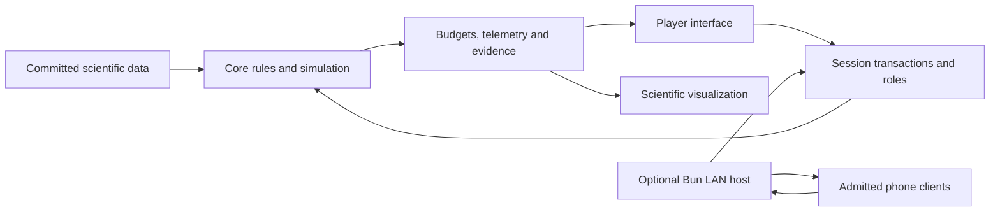

# ASTRIX11 documentation

## System overview

ASTRIX11 is an educational mission-design and operations game built for NASA Space Apps' [Space Mission Design Game](https://www.spaceappschallenge.org/2026/challenges/space-mission-design-game/). Players connect a measurable objective to spacecraft hardware, launch/trajectory choices, resource limits, operations and an evidence-based debrief. It is a reduced teaching simulation, **not flight-planning software, a medical simulator or NASA-certified engineering**.

**Current status:** the [turn-based learning-game revision](./plans/TURN_BASED_EXPLORATION_REVISION.md) is implemented, with final immersive-scene/branding integration underway. Earlier engine, browser, GMAT and multiplayer results are recorded in [Verification](./VERIFICATION.md); they do not automatically verify later presentation changes. The game has a clear **Design & Play** path, not a full design studio; GMAT support stays.

**Pitching or explaining the project?** Start with the [project explainer for the team](./PROJECT_EXPLAINER.md).

### What the player does

1. **Learn, explore, then choose a discovery.** The separate ASTRIX11 landing offers a skippable general mission-design lesson before free solar-system exploration. The mission board is a subsequent action and groups the supported Earth, Moon and Mars goals; **Design & Play** is available to both levels.
2. **Prepare in one workspace.** Choose a bounded ambition, real hardware kit and approach. See objective targets, deadline, cost/fit and constraints together; no naming, publishing or engineering signoff is required.
3. **Check a feasible path.** Compatibility is not enough: a Ready design has a successful reference-policy witness using the actual engine. Changing the design invalidates that proof. Ready is not a guarantee that every choice will succeed.
4. **Choose and preview.** Each decision offers relevant operational plans, expected elapsed mission time, resource changes and the next boundary. Selecting does not execute.
5. **Commit and discover.** One explicit action resolves physics until the next decision or terminal event, then displays a receipt. Thinking and reading consume no mission time.
6. **Debrief and try differently.** Evidence, discoveries, failure causes and same-condition comparisons make the design tradeoff visible. Local decision-boundary saves preserve return-to-play; optional GMAT tools remain outside the ordinary loop.

Aspiring and Expert share this interaction. Expert tightens tradeoffs rather than exposing a second design studio. English/Brazilian Portuguese, keyboard access, reduced motion and compact layouts remain requirements. Scientific details are optional; no numeric orbital elements, attitude controller or burn-vector entry is needed for ordinary missions.

**Immersion and brand:** the 3D scene remains visible throughout the simulator, separate from the public landing. Preparation, turn choices, consequence previews and debrief use contextual panels over the scene. Plan toggles and the guarded commit remain visible outside scrolling panels. Mission names explicitly identify destination, operation and purpose. The supplied ASTRIX11 logo, deep blues and orange actions are shared across entry, loading/recovery, multiplayer and gameplay; existing save/package identifiers are preserved.

The seven-resource grid remains visible during missions, including when panels collapse. Short **Quick tour** spotlights explain current controls; the general mission-design lesson is separately replayable. Camera adjustments persist across decisions. Installed components can be inspected through the spacecraft or a custom dropdown with category icons, localized names and descriptions.

### Components and ownership

| Component | Responsibility | Boundary |
|---|---|---|
| `packages/core` | Mission-definition validation, hardware/quotes, readiness, physics, resources, commands, objective evidence and scoring | The only physical/rules authority; no browser or renderer decides an outcome |
| `packages/data` | Committed scientific snapshots, source registry, topic vocabulary and contextual science bindings | Historical inputs and reference metadata, not live telemetry |
| `packages/session` | Attempts, authenticated actors, turn commitments/proposals, stale checks, idempotency and replay | Same transaction authority for local and LAN play; no wall-clock advancement of a turn game |
| `apps/web` | React mission board/preparation/play, local saves/journal, worker previews, optional GMAT tools and visualization | Projects committed state; selecting, reading and camera movement do not execute |
| `apps/host` | Optional Bun HTTP/WebSocket server, host bootstrap, QR/manual admission and serialized turn authority | One in-memory room, display plus up to three phones; network heartbeat is not a mission clock |
| `scripts` | Scientific snapshot acquisition/reduction, document packaging and independent reference inputs | Preparation/research tools; not a hidden live-data service during gameplay |

Static play dispatches directly to the local session. In LAN mode **only Bun resolves a committed turn**; host and phones receive snapshots, including after reconnect. Phones can propose and the host commits. Losing a connection never starts a second local simulation. Host process restart recovery is not implied by local browser saves.

### Mission definitions, flight and persistence

Designs bind to resolved immutable definitions and content digests. The same objective evaluator serves the original challenges and short lessons; quick configuration compiles bounded choices into real paid hardware and constraints. Definition validation/import/export remain content and preservation tools, not a mandatory full-studio player workflow. Unsupported fields/capabilities are refused, not silently guessed.

Short lessons distinguish returning data, suborbital ascent, entering orbit, raising an orbit, reaching an entry boundary, escaping Earth and encountering the Moon. The complete lunar-orbiter path adds launch, parking orbit, injection, encounter, capture and data return. Surface ascent uses a reduced staged finite-thrust model; coast and lunar transitions use patched two-body conics; burns are explicitly impulsive and consume fuel. Mars retains its separate analytical cruise/capture model. No lunar landing, real lunar ephemeris or continuous three-body propagation is implied.

Local saves are versioned decision-boundary attempts, distinct from old saved mission definitions. Corrupt/incompatible saves must remain explainable/exportable, and failed writes preserve the previous valid save. LAN refresh recovers only while Bun remains alive. Definition/configuration identity, rules/model/policy versions, level, seed and assistance qualify comparisons; old results are never relabelled.

## NASA resources: what we use and how

NASA engagement has four distinct forms: **design methodology, numerical/reference material, historical scientific data, and imagery**. A citation is not automatically a runtime dependency. The tables below distinguish actual use from inspiration and identify supplemental resources that are not NASA publications.

### Challenge-listed design and validation resources

The source registry flags these as challenge-listed resources. That flag records provenance; it does not establish organizer approval or award eligibility.

| Resource | How ASTRIX uses it | Scope and limits |
|---|---|---|
| [NASA CubeSat 101](https://www.nasa.gov/wp-content/uploads/2017/03/nasa_csli_cubesat_101_508.pdf) | Informs CubeSat packaging/mass constraints and explanations of spacecraft fit; the catalogue cites it for the selected 3U class screening rule | ASTRIX's particular dispenser contract is not a universal CubeSat rule; fictional parts are not certified hardware |
| [NASA Design and Develop Science Missions](https://www.nasa.gov/wp-content/uploads/2025/04/250323-design-and-develop-science-mission.pdf) | Provides the mission-development framing: need/objective, connected system segments, requirements, design trade, verification, implementation and review | Adapted into an educational game, not a real agency approval process |
| [NASA/JPL Concept Maturity Levels](https://dataverse.jpl.nasa.gov/dataset.xhtml?persistentId=hdl:2014/44299) | Informs concept-development terminology and explanations of evidence needed before advancing | Game completion does not confer an official CML |
| [NASA Goddard Mission Design Lab](https://etd.gsfc.nasa.gov/capabilities/mission-design-lab/) | Informs collaborative discipline roles and coupled design decisions across science, spacecraft, launch/orbit and ground/comms | Role play and approvals are a simplified teaching workflow, not participation in NASA's lab |
| [NASA General Mission Analysis Tool (GMAT)](https://software.nasa.gov/software/GSC-19468-1) | Runs separately as an independent orbital reference. Repository scripts describe comparable initial states, orbit/transfer cases and the new conic reference cases; bounded GMAT/OEM tools support explicit interchange/viewing | Not bundled and not required for gameplay. Existing and new reference runs have separately recorded scope; a conic match does not validate ascent, lunar targeting, resources or full mission success |
| [NASA Mission Viz](https://nasa.github.io/mission-viz/) | Reference for communicating trajectories and orbital geometry | Visualization precedent, not an imported NASA simulation engine or copied asset collection |
| [NASA Webb Build It Yourself telescope game](https://science.nasa.gov/mission/webb/game-build-it-yourself/) | Precedent for teaching coupled instrument/spacecraft choices and reviewing their consequences | Design/learning reference; ASTRIX does not reproduce Webb's engineering model |
| [Canadian Space Agency games and activities](https://www.asc-csa.gc.ca/eng/youth-educators/digital-games-and-activities.asp) | Educational-game precedent and educator reference | Challenge-listed, but **CSA, not NASA**; not a runtime dataset |

Independent runs, script inputs and comparison limits are in [GMAT reference research](./research/gmat-validation.md). The [challenge acceptance map](./CHALLENGE_ACCEPTANCE.md) explains how gameplay addresses the challenge, separately from submission eligibility.

### Scientific data and numerical references

| Source | Concrete use in the system | What it does not establish |
|---|---|---|
| [NASA NSSDCA fact sheets](https://nssdc.gsfc.nasa.gov/planetary/factsheet/) — Earth, Moon, Mars and Sun | Source-labelled constants for the reduced geometry/flight models, including body sizes and gravitational/orbital reference quantities; consumed through core physics and lunar modules | Full precision ephemerides, certified navigation or the omitted perturbations |
| [NASA OSDR RadLab](https://visualization.osdr.nasa.gov/radlab/gui/data-api/) | A committed ISS/Columbus/DosTel1 record for 10–11 May 2024 is reduced into 48 hourly dose-rate means. Core replays these measured values during the declared radiation exercise; Explain shows interval, provenance and limitations | Live space weather, a global orbital radiation map, a medical dose model or calibrated electronics-failure probabilities |
| [NASA CCMC DONKI](https://ccmc.gsfc.nasa.gov/tools/DONKI/) | Preserved May 2024 geomagnetic-storm records and a selected CME with its analyses provide archived event/source context | DONKI event speeds/Kp do not drive spacecraft dose or damage equations; co-occurrence does not prove the cause of a RadLab peak |
| [NASA's May 2024 Mars solar-storm account](https://www.nasa.gov/solar-system/planets/mars/nasa-watches-mars-light-up-during-epic-solar-storm/) | Context for explaining Mars radiation and the difference between surface observations and the authored orbital exercise | Curiosity's surface measurement is not a measured Mars-orbit radiation profile |
| [NASA Life Support Baseline Values and Assumptions, Rev. 2](https://ntrs.nasa.gov/api/citations/20210024855/downloads/BVAD_2.15.22-final.pdf) | Table 3-31 supplies per-person daily O₂, CO₂, potable-water and dry-food baselines for the four-person crew exercise; the model tracks finite stores and retained waste | A validated spacecraft life-support design, individual physiology or a diagnosis |
| [NASA-STD-3001 Volume 2](https://www.nasa.gov/wp-content/uploads/2025/05/nasa-std-3001-vol-2.pdf) and [NASA ECLS/LiOH material](https://ntrs.nasa.gov/api/citations/20180002051/downloads/20180002051.pdf) | References behind crew-atmosphere, habitability and scrubber explanations, alongside explicitly authored cabin and equipment assumptions | Compliance certification or proof that the game's coefficients reproduce certified equipment |
| [NASA Small Spacecraft Technology](https://www.nasa.gov/smallsat-institute/sst-soa/) | Phenomenological references for thermal control, power, pointing, radio and computing explanations; helps explain why design choices have coupled effects | Manufacturer-calibrated fictional parts, fault probabilities or mission-life predictions |
| [USGS Astrogeology](https://astrogeology.usgs.gov/) | The local `nasa.json` export supplies mission-facet counts and sample product links shown in Red Relay's real-mission context | Despite the filename, the catalogue is **USGS**. Product-to-mission matching is title/name-based and explicitly heuristic; returned game data are not real NASA/USGS products |

ASTRIX labels sourced quantities separately from authored assumptions. Watts versus watt-hours, collected versus delivered data, calculated forecasts versus observed simulation outcomes, and source measurements versus teaching parameters remain separate concepts.

### NASA imagery and archival discovery context

| Asset | Current use | Provenance and display limits |
|---|---|---|
| [NASA SVS Blue Marble](https://svs.gsfc.nasa.gov/2915/) and [Black Marble](https://science.nasa.gov/earth/earth-observatory/earth-at-night/maps/) | Earth globe and discovery/debrief context | NASA/GSFC SVS, Reto Stockli, NASA Earth Observatory, NASA/NOAA VIIRS; historical composites, not current weather or the player's observation |
| [USGS/NASA Viking Mars mosaic](https://astrogeology.usgs.gov/search/map/mars_viking_global_color_mosaic_925m) | Mars globe and discovery/debrief context | USGS/NASA Viking, 1976–1980 archival imagery; not live or generated mission data |
| [NASA SVS Deep Star Maps 2020](https://svs.gsfc.nasa.gov/4851/) | Shared sky | NASA/GSFC SVS and ESA/Gaia/DPAC; archival celestial map, not a live sky observation |
| [STEREO/SDO](https://svs.gsfc.nasa.gov/3851/), [MESSENGER](https://science.nasa.gov/photojournal/enhanced-color-mercury-map/), [Magellan](https://science.nasa.gov/3d-resources/venus/), [Voyager](https://science.nasa.gov/3d-resources/jupiter/) | Sun, Mercury, Venus and Jupiter globes | Sun is false-color 304 Å EUV; Mercury is enhanced geological color; Venus shows radar surface, not clouds; Jupiter is an archival atmospheric mosaic |
| [LRO CGI Moon Kit](https://svs.gsfc.nasa.gov/4720/) | Moon globe, including mission views | LROC color mosaic and monochrome polar LOLA albedo, with source processing/inpainting; not an unprocessed photograph |
| [Cassini PDS global maps](https://atmos.nmsu.edu/data_and_services/atmospheres_data/Cassini/sat_global_map.html) | Saturn globe | Observed RGB, not the fictional NASA 3D catalog painting. Black bands mark missing coverage; rings are separate illustrative geometry |
| [Hubble OPAL Uranus](https://archive.stsci.edu/hlsp/opal/opal-uranus-cycle-25) and [Neptune](https://archive.stsci.edu/hlsp/opal/opal-neptune-cycle-25) | Ice-giant globes | NASA/ESA/STScI, CC BY 4.0; enhanced RGB, not natural-eye colors. Black polar regions are unobserved data, not physical dark surfaces |

The [texture manifest](../apps/web/public/textures/asset-sources.json) records exact source URLs, credits, conversion/resizing, coordinate conventions and decoded-memory limits. [CREDITS.md](../CREDITS.md) records attribution and use conditions. Spacecraft geometry and explanatory diagrams are application-generated, not NASA vehicle models. NASA logos or endorsements are not implied.

### How the resources reach gameplay

- **Acquire deliberately:** `bun run snapshot` fetches scientific responses during data preparation, not during a mission. Raw responses retain URL, retrieval metadata and SHA-256. Explicit offline reproduction uses preserved inputs and checks their hashes.
- **Reduce transparently:** RadLab requires all 48 selected hourly buckets and does not interpolate missing hours. DONKI retains distinct event analyses. USGS whole-catalogue facet counts remain separate from the sampled records and heuristic product matches.
- **Commit and bundle:** reduced JSON enters through `packages/data/src/index.ts`; core consumes the applicable measured profile and reference constants. Archival discovery images are served locally. Normal gameplay makes no runtime NASA/USGS data-API request.
- **Expose the evidence:** topic explanations, translated assumptions, source metadata and bounded mission comparisons accompany simulated discoveries. Reference checks, previews and actual receipts remain distinct. External source/product links still need connectivity when opened.
- **Verify the right claim:** data provenance checks, physics/reference comparisons and browser interaction checks answer different questions. None substitutes for scientific review, novice-user research, physical-phone qualification or organizer approval.

Detailed reductions, retrieval qualifications, licences and update commands live in [Resources](./RESOURCES.md); numerical assumptions live in [Technical models](./TECHNICAL_MODELS.md) and source code. This overview is a reading map, not a second source registry.

## Where to start reading

- **Understand or demonstrate the game:** [Missions](./MISSIONS.md) → [Layouts](./LAYOUTS.md) → [Science UX](./SCIENCE_UX.md).
- **Change the engine:** [Architecture](./ARCHITECTURE.md) → [Simulation](./SIMULATION.md) → [Technical models](./TECHNICAL_MODELS.md).
- **Audit scientific use and attribution:** [Resources](./RESOURCES.md) → [Credits](../CREDITS.md) → [Verification](./VERIFICATION.md).
- **Run a shared session:** [Multiplayer](./MULTIPLAYER.md), including plaintext-LAN warnings, host bootstrap, device limits and pending physical-device checks.

## Refinement specification and acceptance

[SIMULATOR_REFINEMENT_SPEC.md](./SIMULATOR_REFINEMENT_SPEC.md): historical refinement, superseded by the guided redesign where it specifies four-stage navigation, the dock, or no follow camera.

[MISSION_FLOW_REFINEMENT_SPEC.md](./MISSION_FLOW_REFINEMENT_SPEC.md) and the [guided immersive redesign](./plans/GUIDED_IMMERSIVE_REDESIGN_PLAN.md) preserve historical design context. Their stage/signoff workflow is superseded by the turn-based revision; the user's persistent-scene/turn-panel requirement remains binding.

## Canonical system documentation

These pages explain the **implemented system**. Start with Architecture, then follow the component relevant to your change. Source code defines current behavior; update its canonical page when that behavior changes. The implementation plan and research briefs preserve decisions and proposed work, not a second runtime specification.

**Current integration status (2026-11-15):** canonical pages now describe the rules-v5 mission-definition, launch/lunar-flight and concept-tour contracts under implementation. The combined build, numerical comparison and browser/LAN acceptance pass is still pending. Earlier verification entries apply to their recorded builds, not automatically to this work.

| Page | Responsibility |
|---|---|
| [ARCHITECTURE.md](./ARCHITECTURE.md) | Packages, public contracts, state ownership, transactions, lifecycle, dependency boundaries and change routing |
| [MISSIONS.md](./MISSIONS.md) | Built-in challenges, short learning missions, Expert mission definitions, objectives, roles, failures and replay |
| [RESOURCES.md](./RESOURCES.md) | Spacecraft budgets and constraints; scientific data acquisition, snapshots, provenance, evidence and redistribution |
| [SIMULATION.md](./SIMULATION.md) | Clocks, ascent, conics, lunar frame transitions, burns, command delivery, resources, objective evidence and scoring |
| [RENDERIZATION.md](./RENDERIZATION.md) | Persistent Three.js Canvas, scenes, display coordinates, thumbnails, quality, adaptive resolution and graphics failure boundaries |
| [LAYOUTS.md](./LAYOUTS.md) | Bottom contextual mission control, chapter/panel navigation, draggable tools, responsive sheets, keyboard/pointer behavior and modals |
| [SCIENCE_UX.md](./SCIENCE_UX.md) | CAPCOM guidance, Show me, spotlight tours, copy depth, explanations and accessibility |
| [TECHNICAL_MODELS.md](./TECHNICAL_MODELS.md) | Six bounded engineering mechanisms, parameter units/ranges/provenance, reference bounds and limitations |
| [MULTIPLAYER.md](./MULTIPLAYER.md) | Trusted-LAN Bun host, QR/manual admission, roles, reconnect, deployment and current groundwork limits |

## Evidence and challenge alignment

- [VERIFICATION.md](./VERIFICATION.md): current mission-control and LAN-groundwork evidence, followed by historical rules-v4 redesign, rules-v3 delivery and earlier passes. A procedure described elsewhere is not a claim that it was run.
- [CHANGELOG.md](./CHANGELOG.md): dated summary of shipped changes, newest first.
- [Delivery report](./reports/STREAMLINED_UI_LAN_REPORT.md): implemented UI/session/host scope, integration findings, observed checks and explicit multiplayer limits.
- [CHALLENGE_ACCEPTANCE.md](./CHALLENGE_ACCEPTANCE.md): how implemented mechanics address the official Space Mission Design Game objective; submission eligibility remains separate.
- [Credits and provenance](../CREDITS.md), [project licence](../LICENSE) and [third-party notices](../THIRD_PARTY_NOTICES.txt).

## Design and implementation history

- [GAME_IMPLEMENTATION_PLAN.md](./GAME_IMPLEMENTATION_PLAN.md): original features, constraints, algorithms, execution plan and integration checklist. Use the canonical component pages above for current behavior.
- [GUIDED_IMMERSIVE_REDESIGN_PLAN.md](./plans/GUIDED_IMMERSIVE_REDESIGN_PLAN.md): approved Line B scope, implementation workstreams and acceptance criteria.
- [STREAMLINED_MISSION_CONTROL_PLAN.md](./plans/STREAMLINED_MISSION_CONTROL_PLAN.md): reviewed bottom-controller design, baseline measurements, amendments and acceptance criteria.
- [MULTIPLAYER_LAN_PLAN.md](./plans/MULTIPLAYER_LAN_PLAN.md): main-computer/QR/phone roadmap; session authority, host and pairing groundwork implemented, dedicated phone design/flight consoles remain future work. Follows the UI rather than constraining it.
- [Space Mission Design Game design brief](./challenges/space-mission-design-brief.md): problem, product decisions, audience, scope and later Guided/floating-space decisions.
- [Earlier mission-design mockup](./challenges/space-mission-design-mockup.md): planning sketches, not screenshots or a description of the current default interface.
- [Original resource map](./challenges/space-mission-design-resources-map.md): planned resource-to-screen mapping; [RESOURCES.md](./RESOURCES.md) describes the implemented pipeline.

## Challenge research

- [Custom missions, lunar learning and shorter tours](./research/custom-missions-lunar-learning-and-tours.md): approved implementation direction and research rationale; current contracts and integration status are in the canonical pages above.
- [Space Mission Design Game](./challenges/space-mission-design-game.md): recorded challenge text and listed resources.
- [Build a Junior Astronaut Mission Trainer](./challenges/junior-astronaut-mission-trainer.md): the alternative outpost challenge for ages 7–12, not the shipped ASTRIX mission game.
- [Comparison and recommendation](./challenges/COMPARISON.md): historical comparison of the two challenge directions.
- [Verified facts and data points](./research/verified-facts.md): researched values and source citations; computed teaching values remain qualified.
- [GMAT support](./GMAT_SUPPORT.md): `/gmat` page, supported import/export profiles, 3D view, example inputs and limits.
- [Independent GMAT reference](./research/gmat-validation.md): recorded external reference run and comparison context.
- [Junior trainer resource audit](./research/junior-trainer-resources-report.md): access notes, caveats and suggestions for that alternative challenge.
- [Void Protocol reuse report](./research/void-protocol-reuse.md): approved reuse decisions and pinned-source research. Actual adaptations are listed in [CREDITS.md](../CREDITS.md).
- [Void Protocol gameplay lessons](./research/void-protocol-gameplay-lessons.md): deeper current-source research into missions, progression, resource tradeoffs and balancing limits; proposes first-class quick Design & Play rather than another studio.

## Local research assets

- [nasa.json](../nasa.json): local USGS Astrogeology export, not live telemetry.
- [nasa-visualizer.html](../nasa-visualizer.html): standalone explorer for that export, separate from the React game.
- Original reuse source: `~/dev/void_protocol/` at `218625d`; no checkout is required to run the shipped game.

## Reading deployed documentation

Root dev/build preparation copies Markdown and notices into the static site's public files. It does not render a documentation website or deploy the repository source tree. Source-file links in these pages are repository-relative; use a repository checkout/viewer to follow them. See [RESOURCES.md](./RESOURCES.md#credits-and-public-document-packaging).

## Remaining implementation work

The approved [turn-based exploration revision](./plans/TURN_BASED_EXPLORATION_REVISION.md) is the current execution plan: first-class **Design & Play**, real constraints and feasibility checks, decision-based play for both levels, discoveries/replay, local saves and optional GMAT tools. Final verification includes the production build and actual HTTP/WebSocket multiplayer.

**Implemented 2026-11-15:** the [turn feedback, mission report and density refinement plan](./plans/TURN_FEEDBACK_REFINEMENT_PLAN.md) and the [Explore ship plan](./plans/EXPLORE_SHIP_PLAN.md). What was built, what was checked and what was not are in the [major improvements recap](./recaps/MAJOR_IMPROVEMENTS.md).

The [previous mission-design completion plan](./plans/MISSION_DESIGN_COMPLETION_PLAN.md) preserves historical integration defects only; its studio-first workflow is superseded.
