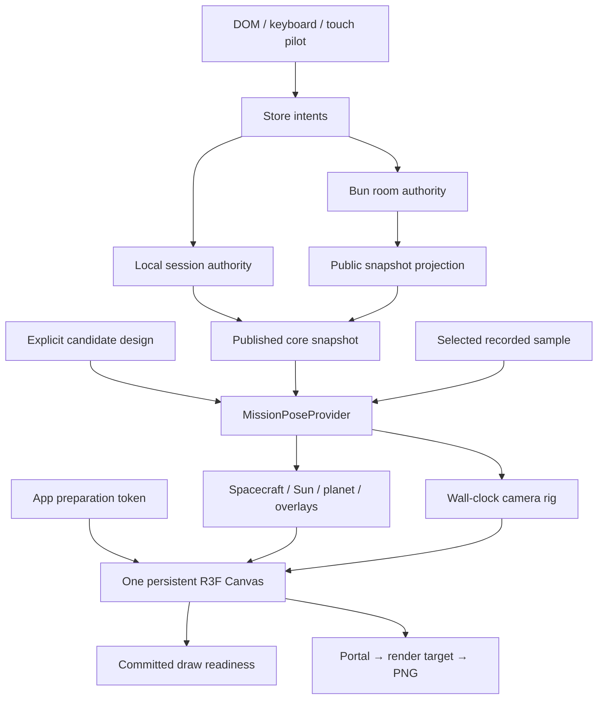

# Rendering

The renderer reads deterministic core state projected by `@astrix/session`; it never advances physics, grants equipment, changes pointing, resources, RNG or score. Commands enter through `useMission` actions, local reduction or authenticated LAN intents, then core command transport. The approved [guided immersive plan](./plans/GUIDED_IMMERSIVE_REDESIGN_PLAN.md), Line B, supersedes the former bench, enlarged-orbit spacecraft and planet-only/no-follow camera conventions; the [streamlined controller plan](./plans/STREAMLINED_MISSION_CONTROL_PLAN.md) supersedes scattered HUD controls.

## Ownership and source map

| Responsibility | Implementation |
|---|---|
| Lazy preparation, cancellation, rollback and retained renderer | `App.tsx`, `ui/screens/Simulator.tsx`, `three/AppCanvas.tsx` |
| Closed mission registry and kilometre shot bounds | `three/missionScenes.ts` |
| Candidate/live/recorded pose authority | `three/space/useMissionPose.tsx` |
| Floating origin and right-handed coordinate conversion | `three/space/FloatingOrigin.ts` |
| Shared sky, Sun, planet and bounded texture residency | `three/space/{SpaceBackdrop,Skybox,SunLight,Planet}.tsx`, `{starfieldShader,atmosphere,textures}.ts` |
| Metre-proportioned procedural spacecraft and catalogue slots | `three/spacecraft/{SpacecraftModel,BusFrame,Dimensions}.tsx`, `{slots,model,materials,workbenchState}.ts`, `parts/PartMesh.tsx` |
| Inspected-component screen tracking for the anchored Component panel | `three/spacecraft/{PartTracker.tsx,projectBounds.ts}` → `ui/layout/trackedTargets.ts` |
| Orbit, transfer, launch, assembly and external viewer shots | `three/{OrbitScene,TransferScene,LaunchScene,AssemblyScene,TrajectoryScene}.tsx` |
| Camera modes, wall-clock response and accessibility bridge | `three/camera/{CameraRig.tsx,modes.ts,approach.ts}`, `ui/scene/CameraControls.tsx` |
| Timeline, commands, pilot input, decisions and events | `ui/flight/*` |
| Bottom spacecraft-slot DOM alternatives and scene model limits | `ui/guide/MissionControl.tsx`, `ui/scene/{WorkbenchControls,SceneCaption}.tsx` |
| Same-renderer snapshots and adaptive resolution | `three/{previewSnapshots.tsx,AdaptivePixelBudget.tsx,pixelBudget.ts,quality.ts}` |

The obsolete root `SpacecraftModel.tsx` and `MissionCamera.tsx` adapters, fixed points stars, workbench floor and permanent camera button grid are removed. The detailed CameraBridge actions remain deliberate non-drag alternatives.

## 1. One lazy, persistent Canvas

Home is DOM-only before first entry. The first entry lazily imports Simulator; its one `AppCanvas` and one WebGLRenderer then remain mounted across stages, previews, replay, help, mission replacement and return to Home. There is no mission/phase key on Canvas and no second WebGL root for cards, Explain or mobile.

Preparation acknowledges scene validation, mounted DOM controls/CameraBridge and an actual committed draw with render calls on a non-lost context. `CommittedDraw` owns that existing root's draw through positive R3F priority. It is not another renderer or a simulation loop. App's attempt token rejects late callbacks and retains prior mission/live state for cancellation or failure rollback. Loading has no fabricated progress percentage or minimum cinematic delay.

NASA imagery loads asynchronously without suspending entry. The first real draw may use the original procedural sky/plain planetary surface, then invalidate when an image is committed. A high-tier load failure attempts the local 1k image; exhausted assets report a surface error without changing physics or creating fake telemetry.

Candidate selection never reads the unrelated active flight. Review reads recorded position, Sun, station and attitude from `HistorySample`; unrecorded deployment/transmission/science effects are suppressed. Crew return/recovery is an abstracted phase without a vehicle trajectory: the original orbit is reference only, and the spacecraft, station, active beam and forecast arcs are hidden.

`MissionPoseProvider` reads authoritative published telemetry/history in either mode. LAN snapshots do not start a second browser simulation, and the current renderer does not implement network pose interpolation or prediction. Disconnection leaves a stale projection, not a locally advancing flight. Candidate preview and recorded replay remain explicitly separate sources.

## 2. One physical coordinate convention

Core positions remain CPU double-precision **MJ2000Eq kilometres**. Render directions use the proper rotation

`[x, y, z]core → [x, z, −y]render`.

This is a −90° rotation around X, not the former reflected `[x,z,y]` conversion. `FloatingOrigin` subtracts CPU positions **before** converting/uploading floats:

- close Workbench/Inspect/Chase/Cinematic: origin = spacecraft position; the craft stays at zero and planet/station positions are relative to it;
- Map/heliocentric transfer: origin = planet centre/Sun respectively;
- external imported trajectory viewer retains its independent normalized body display but uses the same right-handed axis conversion.

The body-local spacecraft mesh is in metres, converted once by an outer `0.001` scale. Its world quaternion is `coreToRender × attitude.q`, where `q` maps body to MJ2000Eq. Core rules v4 defines **+X panel normal**, **+Z instrument and directional antenna boresight**. No cosmetic banking changes physical attitude. Recorded review uses the historical quaternion, never the current live one.

Earth/Mars surfaces use their core kilometre radii. Close shots show the actual spacecraft envelope. Map shots use a screen-size icon and label instead of enlarging the mesh. Lines, apsis/station markers, packet glyphs and labels are overlays, not solid physical geometry. `labelBudget` gates map labels; pilot anchors and dimension labels are shown only in their explicitly enabled surfaces.

The renderer requests `logarithmicDepthBuffer: true`, perspective FOV 43°, a close-shot near plane of `10⁻⁷ km` and far plane at least `10⁹ km`. The custom sky, Sun, planet and atmosphere shaders include logarithmic-depth chunks. Sky fragments are explicitly at depth 1; the angular Sun is just in front of the sky and can be occluded by opaque bodies. No two-pass fallback is claimed: LOW-device depth artefacts still require the integration browser gate.

## 3. Spacecraft workbench

`BUS_GEOMETRY` declares the 3U envelope **0.10 × 0.34 × 0.10 m**, approximate authored SmallSat **0.8 m cube**, and approximate authored capsule/service stack **4 m diameter × 6 m height**. These latter dimensions are not a flight-vehicle replica. Deployables extend outside the bus envelope. Slot envelopes, clearances and component dimensions are procedural illustrations, not CAD qualification.

Every catalogue part ID has an explicit per-bus slot and shape. Positive `Design.parts` quantities create individually countable solids; foreign-bus, absent or zero-quantity parts do not appear installed. Materials distinguish solar cells, foil, rails, lens glass, antennas, tanks/nozzles and sensor hardware. There are no imported spacecraft models.

The room cells visualize the core's U/BAY budget: the three 3U volumes fill from actual installed volume, and overflow is red. BAY is an abstract resource, not cubic metres or a solved packing model. A translucent ghost is only the current actual proposal, not presumed mission equipment. Installation/removal and exploded view use short wall-clock presentation transitions, with immediate/static behavior under reduced motion. Deployment reflects core deployment status; an animation does not deploy hardware on its own.

Presentation state lives in `three/spacecraft/workbenchState.ts`, not the mission store:

- `hoveredCategory` links Workshop card focus/hover to slot highlighting;
- `selectedCategory` filters the Workshop after a slot click;
- `inspectedPartId` names the component whose details panel is open (device-local, never synced or scored);
- `previewPartId` and `previewOrbit` carry the uncommitted proposal;
- `exploded`, `dimensions`, `turntable` are device-local switches.

Picking requires less than 5 CSS px movement, so orbit dragging does not install/select a part accidentally. A slot click selects its category and opens that component's details; in the close orbit view, an installed part opens its details too (`SpacecraftModel inspectable`, off for preview snapshots, launch storyboard and reference-only shots). Hover shows a pointer cursor; the inspected part stays highlighted. `PartTracker` and `projectBox` retain their per-frame viewport projection, side stability and detach-on-drag behavior unchanged. The bottom controller is an occupied HUD zone; its measured top bounds the anchored Component panel. DOM slot/category/component buttons now mount once inside MissionControl, not AppCanvas's scene overlay. They retain keyboard/non-drag equivalents, view-only inspection in flight and adjacent scientific evidence. Dimensions distinguish approximate envelopes. Turntable is opt-in, stops during interaction and is disabled by reduced motion. Scene picking never calls `addPart`, applies a quote or issues a command.

## 4. Shared sky, Sun and surfaces

All mission shots share one open-space backdrop: no floor, bench or atmosphere/weather field surrounds the craft. The sky uses NASA SVS [Deep Star Maps 2020](https://svs.gsfc.nasa.gov/4851/), with a fixed original procedural fallback if imagery is unavailable. The real sky is paired with core rules-v4's low-precision solar ephemeris; it must not be paired with the old arbitrary equatorial Sun circle.

### Explicit celestial orientation

The SVS image is celestial ICRF/J2000 right ascension/declination, with RA zero at the image centre, RA increasing **left**, north at the top. The shader does not rely on Three's default equirectangular orientation or `backgroundRotation`:

1. Convert core to render with `[x,z,−y]`.
2. For normalized render direction `d`, compute `ra = atan2(−d.z, d.x)` and `dec = asin(d.y)`.
3. Sample `u = 0.5 − ra/(2π)`, `v = 0.5 + dec/π` with horizontal repeat and explicit image Y orientation.

Thus core +X (RA 0°, Dec 0°) samples `(0.5,0.5)`, core +Y (RA 90°) samples `(0.25,0.5)`, core −X is the seam, and core +Z points to the northern celestial pole. Camera translation is excluded in the sky vertex shader, so neither the floating origin nor chasing the craft rotates the star map. Integration must visually check these anchors and the W11 Sun's seasonal obliquity against the same MJ2000Eq frame; typechecking alone cannot establish sky orientation.

The fallback GLSL is independently implemented with integer lattice mixing, elementary multiply/shift/XOR/LCG arithmetic. **No Dave Hoskins hash or unknown-licence shader is copied.** It is an illustrative star distribution, not a scientific catalogue or changing observation.

`SunLight` uses the pose's core solar direction for both the angular disc and directional light. Its angular radius uses the solar radius 695,700 km and the model's body distance; glare is an illustrative halo. Core `sunlit === false` sets spacecraft illumination to zero. Planet shading retains the same unoccluded Sun vector, so entering spacecraft eclipse does not turn off the planet or move its terminator. Small ambient fill is presentation only.

Earth HIGH/MEDIUM uses historical cloudless January 2004 Blue Marble RGB and Black Marble 2016 night-light luminance. Night alpha is data, not transparency; its warm display tint is illustrative. LOW omits night lights. Mars retains the local Viking/USGS map and a thin rim. Fresnel shells are display atmosphere cues, not scattering/weather or a pressure model. Longitude uses the core's reduced uniform rotation; it is not precision IAU geolocation or current weather.

Primary source URLs, exact originals, processing and credits are committed in [`public/textures/asset-sources.json`](../apps/web/public/textures/asset-sources.json) and [Credits](../CREDITS.md): NASA/Goddard SVS; Gaia DR2 ESA/Gaia/DPAC; NASA Earth Observatory/GSFC, Reto Stockli; NASA/NOAA Suomi NPP VIIRS; USGS/NASA Viking. No NASA endorsement is implied.

### Residency policy: decoded bytes, not compressed download bytes

The shared loader reference-counts filenames, aborts/releases unused images, closes ImageBitmaps, preserves non-premultiplied packed RGB and **disables mipmaps**. Textures use linear filtering. HIGH/MEDIUM Earth's day RGB and grayscale night channel are offline-packed into one lossless RGBA WebP; using separate day/night 4k allocations plus a 4k sky would be 96 MiB without mipmaps and is not the implemented policy.

| Steady resident maps | LOW | MEDIUM/HIGH |
|---|---:|---:|
| Earth surface + sky | 1k day 2 MiB + 1k sky 2 MiB = **4 MiB** | 4k packed Earth 32 MiB + 4k sky 32 MiB = **64 MiB** |
| Mars surface + sky | 1k Mars + 1k sky = **4 MiB** | 1k Mars + 4k sky = **34 MiB** |
| Transfer Earth + Mars + sky | three 1k allocations = **6 MiB** | 1k Earth + 1k Mars + 4k sky = **36 MiB** |

The viewer/transfer never mount an extra high-resolution mission planet. These totals are RGBA8 decoded allocations without mipmaps, not JPEG/WebP network sizes or a measured GPU-memory claim. `getSpaceTextureBytes()` exposes shared loaded shader-image allocations. `AppCanvas` adds conventional material maps and exposes `data-quality-tier`, `data-draw-calls`, `data-texture-count`, `data-surface-texture-bytes-estimate` and `data-texture-bytes-estimate` after draws. The historic surface-named metric now includes sky/packed shader textures deliberately. Measure after image residency, not only the first plain-surface draw.

## 5. Orbit, transfer and launch effects

Orbit paths use core two-body propagation, including inclination, RAAN, argument of periapsis and true anomaly. Shadow/contact arcs use the same cylindrical eclipse and station/Mars visibility functions as core forecasts. Green means geometric visibility, not service allocation. The station cone represents the modeled 10° minimum elevation, not a booked ground service. Fast-forward Map adds a recent core-propagated orbital trail. A proposal orbit is a separate ghost path; it does not replace the installed design.

A downlink beam exists only for actual `downlinkActive` with a modeled station endpoint. Packet progress derives from delivered MB, not elapsed decoration time. Mars does not get a fictitious surface dish for an Earth link. The imaging surface circle follows the actual +Z boresight/sphere intersection when modeled operating/pointing/light conditions hold; its fixed 30 km display radius is **illustrative**, not calibrated optical FOV or spacecraft image data. No photograph count or generated science image is invented.

Safe color and deployment positions come from telemetry. Pilot boresights show actual panel/instrument directions; a separate faint requested-target line is explicitly a command preview. Torque-couple puff feedback is driven only by published quaternion changes with actual nonzero attitude rate. **Wheel and magnetic ADCS are not RCS thrusters. The puffs are an attitude-change illustration, not measured gas, thrust, fuel use or proof of installed RCS.** Reduced motion removes decorative puff animation; core slewing is not frozen.

Red Relay's heliocentric scene uses `planetPosition(body,t,epochUTC)` for simultaneous Earth/Mars positions and `transferPosition(t,epochUTC)` for the analytical ideal Hohmann path. Surfaces retain true radii; unresolved objects use map icons. Skip cruise advances core through its ordinary store action, while an optional, separately labelled 2.4-second wall-clock time-lapse illustrates that already-computed transfer; Skip/reduced motion omit it. Telemetry and pending decisions are never replaced by interpolated presentation values. This is an ideal two-body transfer without mid-course corrections, not a high-precision ephemeris.

The heliocentric transfer draws the physical Sun at its origin with radius 695,700 km and explicitly suppresses the backdrop's far angular disc. Illumination and sky stay active: there is one Sun, not a second disc in an unrelated apparent direction.

The optional launch storyboard uses an authored metre-proportioned stack over the true-scale Earth limb: lift-off, separation and deployment frames over six wall seconds. Play/Skip/Replay and reduced-motion static frames change presentation only. They do not calculate ascent, consume fuel, change readiness or delay `createSim`.

## 6. Camera and input contracts

| Mode | Behavior |
|---|---|
| Chase | Velocity-aligned boom behind/above the actual craft; radial local vertical |
| Inspect | Explicit free orbit/pan/zoom around the craft |
| Map | Planet/Sun-centred mission overview with screen-size spacecraft icon |
| Workbench | Close orbit around the metre-proportioned design and exploded/dimension state |
| Cinematic | Short skippable authored briefing/event shots; reduced motion chooses a static/manual mode |

Camera response uses wall-clock R3F delta, never simulation warp: exponential rates 3.5/s up, 5/s distance and 2/s recenter. Middle-button quick look and ordinary Chase dragging temporarily suspend tracking; recenter begins after three idle seconds. Semantic identity caches at most 80 poses. Discontinuities (generation/checkpoint, changed shot, backward time, large simulation-time jump) snap instead of easing through invalid space. Self-paced advancing and warp **above 100×** select Map with a motion trail. The camera stays outside the body radius plus near-plane clearance. User movement never issues a pointing command.

Fit/Reset preserve measured framing semantics. The optical clear band reads actual `[data-hud-zone]` roots: identity header, resources and bottom mission control. The old separate CAPCOM and fixed flight-deck roots are removed. `useWindowViewport` supplies the same controller clearance to tools and scene-camera widgets. Reflow updates projection rather than dragging saved poses. Reading layout uses the full in-flow viewport; expanded trays do not cause a layout-class feedback loop.

The compact widget exposes mode, zoom and Fit; details retain every CameraBridge action including pan, focus spacecraft/station, body/orbit-plane view and Reset. Keyboard: **V** cycles, **K** Inspect, **M** Map, **F** Fit, **R** Reset; scoped arrows orbit, Shift+arrows pan, +/− zoom. Inputs/selects/editors/modals are excluded from mission shortcuts. Coarse-pointer camera capture is opt-in Explore 3D; Done/Escape restores ordinary page scrolling/pinch gestures. Pilot capture is a separate explicit mode and never captures DOM panels.

## 7. Flight deck and manual steering

`FlightBar` is embedded in the bottom controller's Flight options; DecisionOverlay/EventToasts remain independent of tool collapse. The forecast timeline uses `forecastTimeline(sim,horizon)` for the next Earth orbit or Mars day, with sunlight, eclipse, contact, target, storm, event and mission-end lanes. It refreshes in bounded simulated-time buckets; the same forecast feeds an always-visible next sunlight/shadow/contact edge with absolute T+ time and advance action. Next-contact information remains visible when the tray or detailed timeline is closed. Unknown edges are explicitly unknown. Selecting an available contact invokes `advanceToEvent(absoluteStartSec)` and still stops at any earlier autopause; it does not upload an operations plan. The timeline is closed by default instead of consuming the default scene area. The public LAN snapshot retains the inputs required for this read-only geometric forecast; outcome scoring instead uses the authority-projected review.

Timeline boundaries are sampled forecasts, not promises of exact sub-step propagation. `advanceToEvent(targetSec)` retains core's accumulated remainder and stops at the requested time budget or an earlier autopause; physical telemetry remains at the last integrated model step/deadline. A target between steps can therefore stop just before physical contact until the next tick. The displayed qualifier is intentional; a 0.25-second forecast boundary is not a claim of a 0.25-second flight integrator.

Hotbar: **1** Sun, **2** Target, **3** Earth, **D** downlink, **S** safe, **G** deployment, **P** pilot. Existing core command previews, power-before/after, contact/light-time explanations, typed refusals and timestamped receipts are retained. In pilot mode D/S are yaw/pitch inputs; their discrete shortcuts resume after leaving pilot. Buttons remain available. Play/pause, warp selection and advance/cancel dispatch session intents through the store; role constraints are not bypassed.

Pilot mode routes pointer/touch scene drags and continuously held **W/S, A/D, Q/E** into target attitude, with an on-screen six-way hold pad. Mouse sensitivity is 0.003 rad/px. An anchor release within 15° selects an ordinary Sun/Target/Earth POINT hold. Camera dragging owns the scene when pilot is off. Blur, pointer cancellation and key release end holds.

Manual targets are ordinary serializable ATTITUDE_TARGET commands, at most **one per 250 ms wall time**, and only at **≤10×** warp. The slow-and-steer button requests a normal role-owned warp change, never bypasses it. The final drag target is retained until the throttle permits sending. Same-actor/gesture commands still WAITING_CONTACT coalesce; **already transmitted intents cannot be recalled or rewritten**, so multiple in-transit receipts are truthful, not suppressed history. Ground vehicles need contact/light time; crew attitudes use onboard transport. Commands do not rotate the mesh until core publishes executed/slewing attitude. Actual hold labels use `telemetry.attitude.hold`, including MANUAL, rather than legacy `telemetry.mode`.

The centred decision region is not a hidden panel and clearly states clock paused. It moves keyboard focus to the decision heading and restores focus when appropriate; Explain/camera alternatives remain reachable because it is not a fake modal. Event toasts offer Show me and dismissal; the full original event log remains in Log.

## 8. Clocks, quality and resource lifetime

| Clock/work path | Authority |
|---|---|
| Static continuous simulation | `useSimLoop` RAF → bounded wall delta → `tickSession` → core |
| Static self-paced simulation | Explicit bounded/cancellable `advanceToEvent` batches through session authority |
| LAN simulation | Bun monotonic `HostClock` → serialized `RoomQueue` → `tickSession`; browser consumes snapshots only |
| Rendering | R3F drawing/invalidation, pose consumers only |
| Camera, install, turntable, launch/time-lapse | Independent wall-clock presentation; no physics writes |

Canvas is continuous while a live implementation runs; otherwise it is demand-driven except finite/opt-in presentation motion. It never draws after latched graphics failure. Pause scope belongs to session policy, not rendering: static hidden/Home/settings/Explain/viewer/tour reasons stop time; LAN optional explanations/tours and phone visibility remain local. Removing a reason never auto-resumes. Reduced motion disables decorative turntable/cinematics/damping/transitions, not scientifically meaningful live position or attitude changes.

| Tier | DPR cap | MSAA request | Orbit samples | Grid density | Label budget |
|---|---:|---|---:|---:|---:|
| LOW | 1 | false | 64 | 8 | 8 |
| MEDIUM | 1.25 | false | 96 | 12 | 16 |
| HIGH | 1.5 | true | 160 | 18 | 24 |

Detection/probing and adaptive GPU pixel budget are retained. Detection reads the existing context; AUTO's one-time median frame probe can downgrade only. GPU adaptation requires WebGL2 plus valid disjoint timer queries, samples at most every 500 ms, and never substitutes CPU timing for GPU pressure. It adjusts DPR, not warp, model accuracy, limits or score. MSAA remains a context-creation request, not a promise that changing tiers recreates the renderer.

Snapshots use isolated R3F portal scenes, a 256×192 render target and the same renderer. Camera framing now derives from each metre envelope. They save/restore render target/clear color/alpha, flip pixels through a temporary 2D canvas and cache at most 60 PNGs. **`gl.getClearColor(new Color())` keeps its explicit destination.** No second context or eager Home renderer is introduced.

`SceneLine` disposes replaced geometry/material; declarative R3F meshes own their lifetimes. Texture references and ImageBitmaps are released on unmount/tier change. Temporary render targets are disposed after capture. A context loss/scene exception latches failure, stops drawing and notifies App to pause with `graphics`; reload/Home are explicit actions, not silent flight recovery. No automatic context-restoration guarantee is claimed.

## 9. Verification ownership

This document specifies source behavior; it does **not** claim fresh runtime verification. The integration owner records actual evidence in [Verification](./VERIFICATION.md).

Focused test sources cover catalogue slot completeness/quantity/room/proposal/picking, camera approach/no-overshoot/frame-rate independence/mode gates, floating-origin precision/right-handed body axes, and real-store pilot throttling/warp gating without render-side attitude mutation. Core owns attitude/forecast/solar ephemeris/transport determinism tests.

Required integration gates: all four missions × levels; persistent Canvas preparation/cancel/failure safety; 1440×900 and 390×844 plus 320 CSS px and reading layout; slot/card hover/preview/install/removal; command refusals and receipts; keyboard/touch continuous steering including release/cancel and contact delay; hidden decisions; reduced motion; en/pt-BR; correct NASA sky anchors/Sun/terminator; shader compilation and packed-alpha RGB; LOW/HIGH steady decoded texture residency, draw calls and comparable frame intervals. A CPU typecheck cannot establish visual sky orientation, WebGL depth behavior, GPU timings or accessibility geometry.

### Browser integration invariants

- Shared custom vertex shaders include Three's `<common>` before logarithmic-depth chunks. `logdepthbuf_vertex` uses `isPerspectiveMatrix`; removing the dependency breaks sky, Sun, planet and atmosphere compilation, not physics.
- Camera presentation records `AUTO` versus `USER` intent. Automatic briefing Workbench completion resolves to Chase for flight; explicit Map/Inspect selection persists. Automatic event shots do not override a user-selected mode.
- `useWindowViewport` measures the resource/header bounds and the bottom controller's actual occupied height. Tools and camera widgets clear that geometry instead of a guessed deck height. Closed-base classification excludes expanded trays/transient notices, while actual bounds still reserve their space. Compact scene widgets use the measured header/resources origin and bottom occupied zone; pilot popovers remain bounded and scrollable.
- Closed tools consume no scene area and have bottom-controller navigation buttons, not floating panel pills. Expanded desktop tools and the anchored Component panel are clamped within the measured workspace. The decision region explicitly restores pointer interaction beneath the shell's non-interactive HUD root.
- In actual core eclipse, close shots show an explicitly labelled **inspection outline** of the authored metre bus envelope. It is an unlit display overlay following actual attitude, not sunlight, emitting hardware, installed equipment or power generation. The real model and core illumination remain shadowed.

- Initial keyboard/pad/touch holds preserve one frame's angular intent immediately, so a genuine tap released before the next RAF is not lost. Continued motion still integrates wall time, key repeat does not duplicate the initial nudge, and the 250 ms send throttle spans successive gestures. A flight-generation guard prevents a delayed final target from entering a replacement mission.

