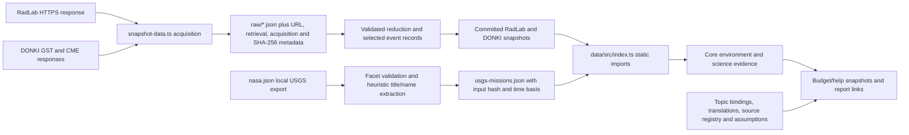

# Resources: spacecraft budgets and scientific evidence

Core owns paid mass, room, budget, power, storage, communications and fuel calculations. Budget units and hardware ratings are authored educational assumptions, not real vendor quotes. The model distinguishes forecasts, accepted requests, executed actions and observed outcomes. [Simulation](./SIMULATION.md) describes integration; [Verification](./VERIFICATION.md) records observed checks, not implied validation.

## Versioned identity and budget

`Design.levelId` is `ASPIRING` or `EXPERT`; definitions/configurations and results carry rules/model identity. Budget is the resolved definition's `vehicle.budget` multiplied by the level allowance (1.30 or 1.275). Quick ambition does not silently raise that allowance. Required hardware, recording capacity and link rate belong to the immutable definition. CubeSat, SmallSat and crew limits are authored class/provider screens, not CAD clearance or certification.

Mass includes structure, purchased parts and loaded propellant. Flight telemetry distinguishes launch mass and current retained mass. Propellant exhaust and modeled leaks reduce retained mass; consumed crew stores and retained waste do not disappear. W is instantaneous generation/load; Wh is battery energy/capacity. Shadow, pointing, power aging and installed hardware determine power. Decimal MB and kbps describe storage and data transfer; collected bytes are not necessarily qualifying delivered bytes. Operations remain constrained by actual contact, link, power and requested state.

Launch-stage fuel and spacecraft fuel are separate inventories. Finite ascent and impulsive trajectory burns must debit their selected inventory and update retained mass. Planning forecasts are not flown fuel or objective evidence; a rejected maneuver cannot spend fuel or move the spacecraft. Definition revisions and digests travel with the design so resource calculations never depend on a mutable browser library lookup.

Crew Pathfinder includes finite O₂/N₂, food, water, scrubber and cabin gas inventories. The per-person BVAD Rev. 2 baseline is 0.895 kg oxygen, 1.085 kg CO₂, 3.217 kg water and 0.800 kg dry food per day. Metabolic heat is not electrical consumption. Crew support calculations, fan operation and recovery-inclusive time continue during elapsed flight. Store runway assumes working support hardware and cannot mask a failed fan. Cabin gas uses an authored free volume and temperature; this is not individual physiology or a medical outcome model.

Before launch, `planCrewSupport(design)` derives its inventory and limiting runway from the same initial crew model used by flight. It compares that runway with the nominal orbit, deorbit burn and six-hour recovery, assuming the installed support hardware is working and powered. If support is not installed, the forecast reports unavailable inventories rather than a zero-health value; readiness still requires the hardware.

Planning and actual telemetry are separate. The core computes budgets, orbit/eclipse/contact forecasts, requirements and launch readiness; a proposal carries actual before/after values. Hardware changes invalidate revision-bound baselines and verification. Crew/mission-specific requirements are applicable only to their scenarios. A paid ground-service economy is not inferred from a general budget: only explicitly modeled charges may consume an operations reserve.

### How resources are presented

The web app displays core budgets and telemetry, never computes a second physical budget. Preparation emphasizes cost, fit, target and deadline; the normal turn workspace shows relevant Fuel, Energy and Data indicators, with additional imminent-failure warnings where needed. W/Wh, stored/delivered data, contact and mission time remain distinct. Preview deltas belong to a candidate resolution; receipt deltas belong to the committed outcome. Unknown forecasts remain unknown, never green.

Optional Details retain catalogue specifications and scientific assumptions. Installed kit parts are real paid configurations, not free narrative equipment. Resource histories from an external GMAT trajectory are unavailable: a position sample cannot supply power, propellant or data evidence.

## Scientific evidence

`Q` values distinguish source provenance from authored assumptions. Constants, historical ISS measurements, calculated game forecasts and fictional hardware ratings have different evidential status. ISS dose replay is not a global radiation map or calibrated electronics failure rate. Spacecraft deployment probability, drag screening, crew vehicle specifications and relay coverage are authored abstractions. The [source registry](../packages/data/sources-extra.json) includes BVAD, NASA-STD-3001, CubeSat design guidance, GMAT and texture provenance; citations do not certify the simulation.

## Acquisition → provenance → runtime → evidence

All runtime data imports are local committed JSON via [packages/data/src/index.ts](../packages/data/src/index.ts). Gameplay makes **no runtime NASA/USGS data-API request**. External evidence/product links still require connectivity when opened; this is not a claim that all linked websites or products are available offline.

### Acquisition and failure behavior

The root [package.json](../package.json) exposes `bun run snapshot`, which runs [scripts/snapshot-data.ts](../scripts/snapshot-data.ts):

- **Normal acquisition:** RadLab, DONKI GST and DONKI CME are requested concurrently, each with a 120-second timeout and JSON accept header. Non-OK HTTP, network/timeout failure or invalid JSON fails acquisition; successful raw text is preserved with URL, retrieval timestamp, acquisition description and SHA-256.
- **Explicit RadLab import only:** if its live attempt fails and `RADLAB_IMPORT` names a file, that raw response is parsed and preserved. The estimated retrieval time is the imported file's modification time. Metadata explicitly records the import, time limitation and live failure. This is not a fresh successful API retrieval, automatic stale-cache fallback or synthetic data. DONKI acquisitions have no corresponding import fallback.
- **Explicit offline mode:** `bun run snapshot --offline` reads each existing raw response and provenance sidecar; URL and SHA-256 must match. It retains the recorded retrieval time and makes no API request. Missing files, mismatch or invalid JSON fail rather than inventing replacements. `RADLAB_IMPORT` is not used by this branch.
- **Shared reduction requirements:** a required CME activity ID and nonempty GST array must exist; RadLab must satisfy its measured-profile checks; required USGS facets must be non-negative integers. Failures throw. The script is not a transactional directory update: concurrent acquisitions or snapshot writes can leave some files updated when another operation fails. Do not treat a failed command as a complete refresh.
- **USGS input:** both modes read the local root [nasa.json](../nasa.json); the script does not fetch the catalogue. Its snapshot records the input hash, total, sampled-record count and preserved export-file modification time. Original HTTP retrieval time is explicitly unavailable.

The committed raw sidecars for [RadLab](../packages/data/snapshots/raw/radlab.provenance.json), [GST](../packages/data/snapshots/raw/donki-gst.provenance.json) and [CME](../packages/data/snapshots/raw/donki-cme.provenance.json) record direct HTTPS acquisition on 2026-11-14. These are repository records, not new live checks performed for this document. A matching hash binds the stored response text to its sidecar; it is not an independent publisher signature or scientific validation.

### Reduced products and their limits

| Product | Transformation | What must not be inferred |
|---|---|---|
| [radlab-dostel1-2024-05-10.json](../packages/data/snapshots/radlab-dostel1-2024-05-10.json) | Select ISS / Columbus / DosTel1, 2024-05-10 00:00 inclusive to 2024-05-12 00:00 exclusive; reject invalid selected doses; require all 48 UTC hourly buckets; take unweighted arithmetic mean per hour, no interpolation | Raw min/median/max describe the 1,886 selected readings, not hourly means. The committed raw statistics are 1.21 / 4.59 / 527.29 µGy/h. This is a local instrument record, not a global environment map. |
| [donki-2024-05.json](../packages/data/snapshots/donki-2024-05.json) | Preserve GST records for the requested May interval and select `2024-05-20T05:36:00-CME-001` from the CME response, including distinct analyses and retrieval times | This is event/narrative evidence; the simulation does not derive dose or hardware loss rates from DONKI speeds or Kp. The exported `DONKI_SNAPSHOT` is not a live mission driver. |
| [usgs-missions.json](../packages/data/snapshots/usgs-missions.json) | Preserve authoritative whole-catalogue mission facets and extract up to three sample products per selected Mars mission using title/name vocabulary | The export contains 1,000 sampled records against a catalogue total of 1,643. Facet totals and the sample are not the same population. Empty examples do not mean zero mission products. |

**USGS counts and matches are different claims.** `extractMissions()` reads counts directly from `facets.missikey.facet`; a missing/invalid requested facet is an error, not zero. Per-product mission attribution is **heuristic** because exported records have no per-record mission field. Mission/instrument expressions inspect title plus normalized name, exclude explicit other-world names, retain input order and take the first three matches. Generic Mars titles are not assigned to every Mars mission.

The **Themis Regio fix** excludes explicit Venus and other non-Mars world names before instrument matching, preventing a Venus place name from being mistaken for Mars Odyssey's THEMIS instrument. It reduces that false match; it does not turn vocabulary matching into verified mission metadata. [snapshots.test.ts](../packages/data/src/snapshots.test.ts) preserves the regression. Real-mission comparisons must label catalogue counts and heuristic product links separately from the player's simulated discoveries.

### UI evidence path and source registry

[SCIENCE_TOPICS](../packages/data/src/science.ts) owns the closed topic vocabulary and each topic's source IDs, translated section keys, diagram, related topics and target. [SCIENCE_BINDINGS](../packages/data/src/scienceBindings.ts) maps part/category/field/budget/command/event/refusal/report contexts to those topics. It is the topic authority; duplicating all entries here would create a competing registry. [English](../apps/web/src/i18n/locales/en.json) and [Portuguese](../apps/web/src/i18n/locales/pt-BR.json) own the explanatory text.

The turn UI's [scientific evidence surface](../apps/web/src/ui/play/Evidence.tsx) displays topic explanations, source links, retrieval metadata and translated assumptions independently of WebGL. Reading does not advance a turn. A nominal readiness witness, predicted plan result and measured receipt remain different kinds of evidence; global source lists do not certify a fictional spacecraft. [Science UX](./SCIENCE_UX.md) documents the interaction and provenance contract.

`listSources()` combines the [core source registry](../packages/core/src/catalog.ts) and [sources-extra.json](../packages/data/sources-extra.json). `SourceRef.listedByChallenge` distinguishes the eight flagged challenge resources (CubeSat 101, Design and Develop Science Missions, Concept Maturity Levels, Mission Design Lab, GMAT, Mission Viz, Webb's telescope game and CSA activities) from supplemental constants/data/context sources. It is a registry classification, not endorsement or a promise that a source supplies runtime data. GMAT is an independent validation resource, not a runtime dependency; Mission Viz/game references do not imply copied assets.

Registry `retrieved` dates are authored reference metadata except where explicitly taken from snapshot metadata (the RadLab measured source). The DONKI snapshot retains its own precise GST/CME acquisition times; the USGS snapshot retains its qualified export-file time basis. The runtime `model-assumptions` source URL currently points to the disclosed simplifications section of the implementation plan; the actual current numeric assumptions come from `listAssumptions()` and the code, not an older planned budget or catalogue.

## Redistribution, persistence and maintenance

### Credits and public-document packaging

[CREDITS.md](../CREDITS.md) owns reference credits, selected owner-authorized Void Protocol adaptations, AI disclosure and runtime-library notices. The project [LICENSE](../LICENSE) is Apache-2.0; preserve [THIRD_PARTY_NOTICES.txt](../THIRD_PARTY_NOTICES.txt), including font/library licence texts. External NASA/USGS/CSA links are not endorsements, and a product/thumbnail link does not transfer ownership or give every linked product the same licence. Consult the linked product metadata before downstream reuse. Procedural geometry, diagrams and tones are not downloaded NASA imagery/audio assets.

[prepare-public.ts](../scripts/prepare-public.ts) recursively copies `docs/` to `apps/web/public/docs/` and copies LICENSE, CREDITS.md and THIRD_PARTY_NOTICES.txt into public root. Root `dev` and `build` run this preparation first. It copies documentation as files; it does not render Markdown, refresh scientific snapshots or copy the source tree/raw datasets as standalone public evidence files. Runtime profiles are imported into the application bundle. Repository-relative source links on these pages are intended for repository readers; copying the docs alone does not deploy those source paths. The copy is not a stale-file pruning step.

### Browser persistence and practice snapshots

Local play uses versioned decision-boundary saves, separate from settings, discovery history and old definition-library files. Restores validate configuration identity, rules/model and deterministic committed history. Write failure preserves the previous valid save; corrupt/incompatible files remain exportable. Aspiring checkpoint retries are assisted, while Expert retries are separate attempts. LAN reconnect restores a live Bun room only; credentials do not provide persistence after process exit. Neither level receives free repairs or energy.

### Update workflow and verification pointers

1. Change the correct authority: hardware/budgets in [catalog.ts](../packages/core/src/catalog.ts), physical model in [physics.ts](../packages/core/src/physics.ts), session transactions/permissions in `packages/session/`, references in the source registries, explanatory content in topic/binding registries plus both locales. LAN edits must be typed, authority-requoted intents, not client budget patches. Do not patch a displayed forecast independently of the core result.
2. For scientific-data refresh, run `bun run snapshot` when acquisition is intended, or `bun run snapshot --offline` to reproduce from preserved raw inputs. Use `RADLAB_IMPORT=/path/to/response.json bun run snapshot` only for the explicit, disclosed RadLab fallback; preserve the imported file's provenance limitations. USGS refresh requires the local export input to be updated separately.
3. Review raw text/sidecars, hashes, retrieval/time-basis fields, selected intervals, reduction limitations and all derived snapshots together. Do not relabel a historical record as current or replace incomplete measured hours with invented values.
4. Use the existing focused checks below when verifying a change; this document does not assert they were rerun. Refresh public docs/notices through `bun run prepare:public` or the normal root dev/build command when preparing a deployment.
5. Record actual outcomes and limitations in [VERIFICATION.md](./VERIFICATION.md), and keep this page, [Missions](./MISSIONS.md) and [Simulation](./SIMULATION.md) aligned with changed behavior rather than with earlier plans.

| Existing checks | Relevant guarantees covered |
|---|---|
| [data/snapshots.test.ts](../packages/data/src/snapshots.test.ts) | Raw RadLab hash/reduction/statistics and missing-hour rejection; distinct DONKI analyses; USGS facet/sample qualification, missing-facet rejection and Themis Regio regression; exact SI registry URLs as local assertions, not fresh network checks |
| [data/science.test.ts](../packages/data/src/science.test.ts), [web/i18n/parity.test.ts](../apps/web/src/i18n/parity.test.ts) | Closed topic set, both language depths/limitations, explicit bindings, source identities and assumption/locale resolution |
| [core/design.test.ts](../packages/core/src/design.test.ts) | Design/quote/readiness regression entry point: provenance, charged hardware, ordered refusals, strict limits and fuel planning; inspect current tests before inferring level coverage |
| [core/physics.test.ts](../packages/core/src/physics.test.ts) | Reference geometry, transfer/capture/fuel/light-time calculations and comparison to independently recorded [GMAT results](./research/gmat-validation.md) |
| [sim/sim.test.ts](../packages/core/src/sim/sim.test.ts) | Simulation regression entry point for storage, energy/SAFE, replay, capture and command receipts; current source semantics are documented in [Simulation](./SIMULATION.md) |
| [sim/playable.test.ts](../packages/core/src/sim/playable.test.ts), [sim/golden.test.ts](../packages/core/src/sim/golden.test.ts) | Explicit pilot/reference-trace entry points; test fixtures are not production autopilots or proof of unexecuted level combinations |
| [web/ui/hud/resourceModel.test.ts](../apps/web/src/ui/hud/resourceModel.test.ts), [web/ui/inspector/partDetails.test.ts](../apps/web/src/ui/inspector/partDetails.test.ts) | Seven-badge order, forecast/live units, quote deltas and thresholds; component specifications and live readings sourced only from core telemetry |
| [web/store/mission.test.ts](../apps/web/src/store/mission.test.ts), [core/score.test.ts](../packages/core/src/score.test.ts) | Refusal atomicity, coupled sign-offs, learning snapshot pauses, reset/redesign boundaries and separate fit/energy/progress statuses |
