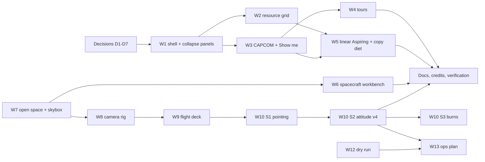

# Guided, immersive redesign plan

**Status:** scope approved by the owner 2026-11-14 (§10): **Line B**, ordered for the Space Apps submission. **Implemented 2026-11-15** (W1-W12 within Line B; S3 burns, W13 ops plan and multiplayer remain out of scope). Owner additions during implementation: styled startup/recovery screens and 404, and a click-to-inspect Component panel for spacecraft parts. Canonical behaviour now lives in `docs/` (LAYOUTS, RENDERIZATION, SIMULATION, ARCHITECTURE); verification is recorded in `docs/VERIFICATION.md`.
**Scope:** `apps/web` presentation layer (shell, HUD, panels, guidance, tours, scenes, camera, flight deck) plus the core additions listed in §8 (attitude model, timeline forecast, dry run). Local multi-device play is planned separately in [MULTIPLAYER_LAN_PLAN.md](./MULTIPLAYER_LAN_PLAN.md).
**Evidence base:** live browser walkthrough of First Light / Aspiring / Solo at 1440×900 and 390×844 (dev server, headless Chromium, quality tier resolved LOW), source reading of `apps/web` and `packages/core`, the canonical docs, and Void Protocol (VP) at pinned commit `218625d`.

---

## 1. Problem and goals

The product claim is: *people cannot plan, simulate and control a space mission end to end; ASTRIX lets them do it as a game.* The current build has the right rules engine but presents it as a form-and-telemetry application. The owner's verdict: "clicking buttons and staring at bland graphics and components instead of actually designing a mission then playing it."

Goals, each with an observable acceptance test (§11):

| # | Goal | Acceptance in one line |
|---|---|---|
| G1 | The 3D scene is the main surface | At 1440×900 ≥ 60 % of the viewport shows the scene with default layout; the spacecraft is never covered by default UI |
| G2 | Exactly one obvious next action | At every point of the First Light / Aspiring journey a single "Next step" card names the action and **Show me** highlights the control |
| G3 | Linear, approachable Aspiring flow | A novice completes design → launch → first downlink without reading any paragraph longer than 25 words |
| G4 | You see the spacecraft you are building | Every installed part is visible on a true-proportioned model; adding/removing a part animates on the model and on the resource grid |
| G5 | Resources always visible, visual | Seven fixed-order resource badges (icon, value, bar, status colour, delta preview) visible in every stage and at 320 CSS px |
| G6 | Spotlight tours | First entry to each surface (Aspiring) runs a skippable spotlight tour; replayable from Help |
| G7 | Open space with a skybox | All mission scenes share one open-space backdrop (sky, Sun, true-scale planet) — no workbench floor |
| G8 | Panels collapse in place | No tab/dock strip; every panel collapses to a draggable pill at its own position |
| G9 | Play is piloting and planning | The player can steer the spacecraft's attitude, follow it with a chase camera, see contact/eclipse windows on a timeline and act on them |

Non-goals: online/internet multiplayer, arbitrary mission authoring, arcade flight physics (§8.4), new missions or bodies.

---

## 2. Current state — what the walkthrough showed

### 2.1 Layout: chrome eats the scene

Measured at 1440×900 in Design (DOM rectangles):

| Element | y range (px) | Share of 900 px |
|---|---|---|
| `.mission-header` (brand, command strip, resource rail, stage list, substep tabs, Preferences) | 0–459 | 51 % |
| `.panel-dock` (tab strip) | 459–512 | 6 % |
| Workspace left for three windows and the scene | 512–900 | 43 % |

- The Mission window body is **273 px tall for 2,504 px of Design content** (≈ 9 screens of scrolling inside a small box).
- Three windows open by default and overlap (Flight review covers Mission readiness). The scene caption (360×207 px) sits at the scene centre and covers the spacecraft and Earth.
- At 390×844 the header is **1,223 px tall** (taller than the screen), the resource rail 832 px, the mission content starts at y = 2,341 and the document is 7,509 px tall; the sticky command strip overlaps the brand.
- Minimising a window sends it to the dock, so the player loses its position; an in-flight decision ("Station in view") was hidden inside the minimised Mission window with only a badge `(1)` on the dock.

Source: `ui/screens/Simulator.tsx:36-42`, `ui/header/MissionHeader.tsx:21-29`, `ui/layout/PanelDock.tsx`, `ui/layout/windows.ts`, `ui/layout/panelLayout.ts:44-49`.

### 2.2 Text-first, and the beginner level is the wordiest

- Locale volume: `en.json` 1,318 keys / 12,345 words; `pt-BR.json` 14,801 words. 58 `ExplainButton` and 29 `TeachingCard` call sites.
- In Aspiring every resource card permanently shows its teaching paragraph (`ResourceTeaching automatic={levelId==='ASPIRING'}`, `MissionHeader.tsx:11,24-27`), so the seven "resources" are seven paragraphs.
- Disclaimers sit on the primary path: "ASTRIX is not an official NASA CML assessment…", "The five-year FCC rule is not universal…", "DESIGN PREVIEW — NO FLIGHT EXISTS… not a CAD clearance", the scene caption's IAU/geolocation limits. Honesty is a project value; the placement is the problem.
- Aspiring still shows engineering jargon: `SCI-QUALITY-01 · Unmodeled · Science lead · Not modeled · r0 · Not evaluated`, "Eclipse energy margin 6.7 Wh", "Mid-latitude ground station · 29.5 min/d".
- The wizard asks five screens of decisions before anything happens, including two independent axes (Level Aspiring/Expert **and** Display depth Guided/Detailed) and Playback speed, before the player knows what they mean.
- `SceneCaption.tsx:23-29` hardcodes `pt ? '…' : '…'` strings outside i18n.

### 2.3 No guidance on "what next"

- Two **Continue** buttons (header primary + panel bottom) and later a header **Launch** that is far from the stage content.
- Stage blockers render as anchor links at the end of the scrolled panel (`ui/phases/Journey.tsx:20`): "Compare a valid proposal with the current design. Freeze the current design revision." — no location, no highlight.
- The First Light starter has no payload. Nothing told me to add the Earth camera: Design let me continue, and the gap surfaced one stage later as "This choice needs Earth camera. Add the required hardware first." plus "Forecast return below target" in a far-right window. Core already knows (`missionRequirements` → `SCI-PAYLOAD-01: FAIL`, `journey.ts:27`).
- Process ritual dominates design: Compare → Confirm change → Freeze baseline → Sign off → Continue → Check this design → Sign off → Continue → Launch → modal Launch.
- The existing 6-step tour (`ui/panels/Overlays.tsx:35-45`) only toggles a CSS class and shows a bottom card. Checked live: 3 of its 6 targets (`design`, `parts`, `orbit`) do not exist in the DOM. It never auto-starts; it is only reachable from Settings.
- After launch the flight auto-paused on a decision whose card was below the fold of the Mission window; the header button read "Mission decision · clock paused" and looked disabled.

### 2.4 Bland visuals

- Background: 200 fixed `pointsMaterial` dots, size 0.12, on `#080f1d` (`three/AppCanvas.tsx:64-71`).
- Design scene: a box "bench", wireframe plane, small planet and primitives (`three/AssemblyScene.tsx`); the spacecraft is ≈100 px tall and hidden behind the caption.
- Orbit scene: Earth radius = 1 inside a 1.65 group, spacecraft scaled 0.15 (≈ 0.3 Earth radii ≈ 1,900 km — "enlarged"), camera orbits the planet only (`three/OrbitScene.tsx:77,84`); FOV 43°, near 0.1, far 150 (`AppCanvas.tsx:137`); 1024×512 Earth map, no atmosphere, no night side.
- Launch: a cylinder rising for six seconds (`three/LaunchScene.tsx`). Transfer: static ellipse (`three/TransferScene.tsx`).
- Camera UI: 14 DOM buttons (rotate ×4, pan ×4, zoom ×2, fit, reset, focus, body, plane) in a disclosure over the scene.

### 2.5 Nothing to fly

- Operation is reading telemetry text and pressing Point Sun / Observe / Point home / Send home / Safe mode inside a scrolled panel, then "Advance to contact" or "Resume continuous playback".
- Pointing is a mode switch with fixed power fractions: "Mode-based attitude model, not a rigid-body attitude simulation" (`packages/core/src/catalog.ts:18`; used in `sim/state.ts:160`, `design.ts:80`). There is no attitude to steer.
- Docs explicitly forbid coupling camera and pointing: "Camera orientation is not spacecraft pointing" (`docs/SIMULATOR_REFINEMENT_SPEC.md:98`), "no hidden follow-camera that fights dragging" (`:217`).
- No view of upcoming passes, eclipses or decisions — the player cannot plan ahead visually.

### 2.6 What is good and must survive

- Core is a clean authority: quotes with before/after budgets, typed refusals, `evaluateJourneyStage` blockers with `id/target/messageKey` (`journey.ts:35-53`), cue rules with `target/fix` (`review/rules.ts`), deterministic `stepSim`, command transport (GROUND waits for contact / light time, ONBOARD for crew and deploy — `sim/commands.ts:120-131`).
- One persistent Canvas, quality tiers, adaptive pixel budget, preview snapshots, WebGL failure path.
- Accessibility work: keyboard/non-drag alternatives, focus restoration, reduced motion, 320 px reflow, inert modals; en/pt-BR parity test.
- Honest disclosure of model limits; seven-resource coverage of the challenge brief.

---

## 3. Root causes

1. **Application shell, not a game HUD.** Every concern got a permanent strip in the header; the scene became the leftover background.
2. **Teaching by paragraph.** Aspiring = more text, instead of more guidance and more visuals.
3. **Gates without a guide.** Core knows exactly what blocks progress, but the UI shows blockers as end-of-panel links instead of one actionable next step.
4. **The spacecraft is decoration.** The model is not the design surface, so "designing" is choosing cards in a list.
5. **No pilot model.** Discrete pointing modes leave nothing to steer; the camera is deliberately detached.
6. **No planning surface.** The future (contacts, eclipses, events) is invisible, so play is reactive button pressing.
7. **Scale conventions per scene.** Each scene invents its own units, which blocks a continuous open space and a chase camera.

---

## 4. Design principles

1. **Scene first.** The 3D view is the screen; UI is a HUD around it. Default layout leaves the centre clear.
2. **One next action.** A single "Next step" card plus one primary button; everything else is secondary.
3. **Show, then tell.** Icons, bars, colour and motion first; text on demand (Explain, popovers). Model limits stay one click away under "Model limits", never deleted.
4. **Direct manipulation.** Click the spacecraft to add parts, drag it to point it, drag the timeline to plan.
5. **Honest immersion.** Every visual is driven by core state or labelled as illustration; no animation implies unmodelled physics; render code never writes simulation state.
6. **Preserve contracts.** Core authority, determinism, one Canvas, keyboard/touch alternatives, reduced motion, 320 px reflow, en/pt-BR parity.

---

## 5. Target experience (First Light, Aspiring, solo)

The seven core stages stay (challenge alignment and core gating depend on them) but are presented as five chapters. Each chapter is a short checklist driven by real state.

| Chapter | Core stages | What the player does | Done when (state, not clicks) |
|---|---|---|---|
| 1 Briefing | NEED_GOALS, CONCEPT, REQUIREMENTS | Camera flies in from deep space to Earth; CAPCOM card: "Deliver 1,500 MB of Earth images in 14 days." **Accept mission**. Segments shown as four linked icons (launch, spacecraft, ground, user) on the scene; requirements as 4 goal cards with gauges | `objectiveConfirmed`, segments complete, requirements evaluable (`evaluateJourneyStage` empty) |
| 2 Build | DESIGN | Spacecraft centred in orbit; steps: add the Earth camera → enough electricity → battery survives the shadow → a radio → pick an orbit (3D preview of the three orbits with contact min/day and shadow %) → freeze the design | `SCI-PAYLOAD-01`, `POWER-ECLIPSE-01`, `GROUND-RADIO-01` pass; no severity-3 cue; trade recorded; baseline = revision |
| 3 Test & launch | BUILD_VERIFY, IMPLEMENT (pre-launch) | **Dry run** (§8.6) shows a forecast of data, battery and storage for the whole mission; readiness checks tick one by one; **Go for launch** (records sign-offs); launch cinematic (skippable) | verified revision, readiness empty, `createSim` |
| 4 Fly | IMPLEMENT | Chase camera; deploy antenna and wings; timeline shows next target pass, contact and eclipse; steer or choose a hold mode; downlink in contact; respond to events | objective met or mission terminal |
| 5 Debrief | REVIEW | Score and stars, replay scrubber, causal recap, one suggested experiment → **Redesign** (opens Build with the relevant slot highlighted, never auto-applied) | — |

Expert: same surfaces, all steps visible at once (non-linear within a stage), Detailed presentation by default, no automatic tours (offered once), technical subsystems and continuous operation as today.

Hot-seat roles and sign-offs keep their semantics; solo keeps actor `ALL`. Multi-device play: see the multiplayer plan.

---

## 6. Information architecture and layout

```
┌──────────────────────────────────────────────────────────────────────────────┐
│ ◆ ASTRIX  First Light · Aspiring   ●─●─●─◉─○─○─○ Build      [ Next step ▸ ] ?⚙│ top bar 48 px
├───────────────┬──────────────────────────────────────────────┬───────────────┤
│ RESOURCES     │                                              │ CAPCOM        │
│ ▣ Mass  ▮▮▮▯  │                                              │ Step 1 of 6   │
│ ⚡ Power ▮▮▯▯  │              3D SCENE (sky, Sun,             │ Add the Earth │
│ ¤ Budget▮▮▯▯  │           Earth, spacecraft, overlays)       │ camera        │
│ ⇅ Data  ▮▯▯▯  │                                              │ [Show me] Why?│
│ ◎ Comms ▮▮▯▯  │                                              ├───────────────┤
│ ◷ Time  ▮▮▮▮  │      ┌ Workshop ─────────────── ⌄ ┐          │ ⚠ Review  (2) │ ← collapsed pill
│ ☺ Crew   n/a  │      │ parts / orbit / checks …    │          └───────────────┘
└───────────────┘      └────────────────────────────┘
│ ▸ Log (5)  ← collapsed pill                  camera: Chase ▾  −  +            │
└──────────────────────────────────────────────────────────────────────────────┘
 In flight the bottom edge becomes: timeline (eclipse/contact/target/events, playhead)
 + hotbar [1 Sun] [2 Target] [3 Earth] [D Downlink] [S Safe] [P Pilot]  ◀ ▶▶ 100×
```

Zones:

| Zone | Kind | Contents | Notes |
|---|---|---|---|
| Top bar | fixed chrome, 48 px | home, mission + level chip, chapter/stage stepper (progress list, not tabs), **one** primary button, Help menu (tours, manual, model limits), Settings | replaces `MissionHeader`; "Set up a new attempt" moves into the Help/menu |
| Resource grid | fixed HUD, collapsible to icons | seven badges (§7.2) | always present, never a panel |
| CAPCOM card | fixed HUD, collapsible to one line | current step, progress, Show me, Why? | §7.3 |
| Panels | floating, draggable, collapse in place | Workshop (stage tools), Review (issues/decisions), Log (events, command receipts), Details (Expert technical forecast) | only Workshop open by default |
| Flight bar | fixed bottom HUD in flight | timeline, hotbar, time controls | §7.7 |
| Camera widget | small fixed control | mode menu, zoom ±, fit/reset; full keyboard set kept | replaces the 14-button grid |

Responsive classes keep their definitions (`panelLayout.ts:56-59`): **desktop** as above; **compact** (< 900 px): top bar + resource grid as a 4/3-column strip of icon badges, CAPCOM one line under it, panels become pills along the bottom edge and the expanded one opens as the adjustable bottom sheet; **reading** (short/zoomed): document flow, same order, no dragging.

---

## 7. Workstreams — presentation

Each workstream lists files, VP reuse (pin `218625d`; line counts verified at the pin), i18n, accessibility and acceptance. New/rewritten components use conventional multi-line formatting (current one-line components such as `MissionHeader.tsx` and `Operate.tsx` are the most expensive files to change); no repo-wide reformat.

### 7.1 W1 — Shell, top bar and collapse-in-place panels

**Design**
- `TopBar` replaces `MissionHeader`. The primary button keeps today's state machine (`MissionHeader.tsx:19-20`: next stage / launch review / decision / capture / skip cruise / pause / advance) but sits in one place and is mirrored by CAPCOM.
- Delete `PanelDock`. `useWindows` visibility becomes `'EXPANDED' | 'COLLAPSED'`. A collapsed panel renders only its header pill (icon, title, badge, chevron) at the same `x/y`, width shrinks to content (min 180 px), and stays draggable. Expanding re-clamps with the existing `clampRectangle` so the body fits the viewport.
- Toggle: chevron button, double-click on the header, Enter/Space on the focused header. The header button carries `aria-expanded` and `aria-controls`. Focus stays on the header after collapse, so the dock focus fallback (`LAYOUTS.md:74`) is no longer needed.
- `showWindow(id, target)` expands in place, raises, then focuses/scrolls the target (same contract as today). Decision and Review badges move from the dock to the pill headers.
- Default geometry: Workshop left/centre-bottom (not full height), Review and Log collapsed on the right/bottom, Details collapsed (Expert). Panels may not cover the central clear band by default; `MissionCamera` view offset is computed from the measured HUD zones instead of header+dock (`useWindowViewport.ts`).
- Stage substep tabs (`Hardware | Ride and orbit | Trajectory`) disappear: CAPCOM steps and Workshop sections replace them.
- "Preferences" and "Advanced tools" move into Settings/Help.

**Files**: new `ui/shell/TopBar.tsx`, `ui/shell/HelpMenu.tsx`; change `ui/screens/Simulator.tsx`, `ui/layout/{DraggablePanel.tsx,windows.ts,panelLayout.ts,useWindowViewport.ts,windows.css,windowCopy.ts}`, `three/MissionCamera.tsx` (clear-band source), `shell.css`; delete `ui/layout/PanelDock.tsx`, `ui/header/MissionHeader.tsx`, dock CSS.
**VP**: `AuraStrip.tsx` (111 LOC) — PATTERN for same-shell collapsed/expanded header with one drag handle. VP's `DraggablePanel` has no minimisation and `HudPanelRail` is itself a strip — LEAVE.
**Tests**: rewrite `panelLayout.test.ts` cases for minimise/restore into collapse/expand (geometry preserved, clamping on expand, independent intents).
**Acceptance**: no element with role `navigation` for windows; collapse/expand by mouse, touch and keyboard; position unchanged after collapse → expand; at 1440×900 default layout leaves ≥ 60 % of the viewport showing the scene; at 390×844 the mission content starts within the first viewport.

### 7.2 W2 — Visual resource grid

**Design**: seven fixed-order badges (mass, power, budget, data, comms, time, crew) adapted from VP `ResourceBadge` / `StatusBar`:
- icon (Lucide) + short label + monospace value/limit + fill bar + status colour with a text equivalent (Fits / Tight / Over, Enough / Low / Short);
- **phase-aware value**: pre-launch shows forecast (chip `FORECAST`), in flight live values (chip `LIVE`): power = battery % with charge/discharge arrow and W in/out; data = storage fill + delivered/target ring; comms = in-contact light or next-contact countdown and queued commands; time = days left ring; crew = runway days or a greyed "n/a";
- **delta preview**: while a part/orbit proposal is open, each affected bar shows a ghost segment and `+0.4 kg` / `−3 W` (data from the existing quote `before/after`, `Budgets.tsx:10`);
- low/over states pulse (disabled under reduced motion);
- click → popover with the sub-values (W vs Wh separated), "What changes this" (parts list) and Explain. The automatic teaching paragraphs are removed from the grid.

**Files**: new `ui/hud/ResourceGrid.tsx`, `ui/hud/ResourceBadge.tsx`, `ui/hud/resourceModel.ts` (pure mapping from `Budgets`/`Telemetry`/quote to badge view-models); delete the resource rail in the header and `ResourceTeaching`; `BudgetsPanel` content moves into badge popovers and the Workshop.
**VP**: `ResourceGrid.tsx` (70), `ResourceBadge.tsx` (139), `StatusBar.tsx` (231) — ADAPT (replace VP stores, enums, icons, formatters; keep card shell, fill transition, threshold pulse, click → detail). `hudLabel.ts` — PATTERN (already adapted).
**Tests**: `resourceModel` unit tests for status thresholds, forecast vs live, crew n/a, W vs Wh; replaces wording-level assertions in `meter.test.tsx` where the Meter is retired.
**Acceptance**: `docs/MISSION_FLOW_REFINEMENT_SPEC.md:582` (A09) holds — all seven visible in every stage, minimised or not, at 320 CSS px without horizontal scroll.

### 7.3 W3 — CAPCOM next-step guide and Show me

**Design**
- Pure resolver `nextSteps(context)` returns an ordered list for the current stage: (1) failing requirements from `missionRequirements` (payload, mass, eclipse battery, radio), (2) active severity-3 cues, (3) stage blockers from `evaluateJourneyStage` (trade, baseline, verify, sign-offs), (4) severity-2 improvements (e.g. `OBJECTIVE_UNREACHABLE`, `DATA_BACKLOG`), (5) in flight: pending decisions, then operational cues (`PASS_SOON_DOWNLINK_OFF`, `STORAGE_FILLING`, `STORM_EXPOSED`) and objective progress.
- Each step: `{ id, owner: RoleId | 'ALL', titleKey, hintKey, target: CueTarget, done(ctx), panel?, section?, sceneTarget? }`; `owner` comes from the requirement owner / cue role / blocker, so hot-seat (and later per-device consoles) can filter steps by role. Completion is computed from state transitions only (VP teaching contract, `docs/TUTORIALS.md` §6.5 in VP): clicking Show me never completes a step.
- **Show me**: expands the owning panel in place, scrolls the control into view and draws a transient pulsing outline that tracks the element while panels move (rAF only while visible). Scene targets (e.g. the camera slot) pulse on the 3D model with a screen-space label.
- Primary button: advances when the stage is unblocked; otherwise reads "Show me: <step>". Guidance never chooses parts, signs off, or issues commands (`MISSION_FLOW_REFINEMENT_SPEC.md:261,297`).
- Aspiring: card expanded, checklist with ticks and a short success cue. Expert: one-line card.

**Files**: new `ui/guide/{steps.ts,nextSteps.ts,CapcomCard.tsx,CueHighlight.tsx,cueStore.ts,cueTargets.ts}`; stable `data-cue-target` attributes on controls; delete `JourneyTask` blocker links.
**VP**: `CueHighlight.tsx` (167) ADAPT; `stores/cueStore.ts` (206 at pin) ADAPT narrowly (request/expiry/subscribe only); `advisor/cueTargets.ts` (16) ADAPT (fall back to the collapsed pill when the target is inside a collapsed panel); `academy.ts` / `MissionsPanel.tsx` / `missionCore.ts` PATTERN only.
**Tests**: `nextSteps` ordering per stage and mission (pure, deterministic); every step's target id exists in a rendered surface (one integration check per stage in the browser verification, not a DOM-wiring unit test).
**Acceptance**: G2 and the First Light starter case: in Build, step 1 is "Add the Earth camera" and Show me highlights both the camera slot on the model and the camera part card.

### 7.4 W4 — Spotlight tours

**Design**
- Tour engine ported from VP: modal and spotlight steps, cut-out over the target (`box-shadow: 0 0 0 9999px`), card beside the target, Back / Next / Skip / Finish, Escape ends. Improvements over VP: viewport-clamped card placement and a bottom-sheet card on compact screens; ←/→ and Enter keys; focus moves to the card and returns to the opener; target tracked with rAF while visible (panels are draggable); missing target → centred card that remains navigable; reduced motion disables transitions.
- Tours are short and per surface: **Welcome** (scene, resources, CAPCOM, Workshop, top bar — 5 steps), **Build** (spacecraft slots, part card, delta preview, confirm, freeze — 5), **Launch** (dry run, checks, go — 3), **Flight** (timeline, hotbar, pilot mode, camera, time — 5), **Debrief** (score, replay, redesign — 3).
- Aspiring: auto-start on first entry to each surface, 600 ms after the scene is ready; Expert: one "Take the tour?" offer. Completion per tour persisted under `astrix.tours.v1` (replaces `Settings.tourDone`). Restart from Help. Tours are device-local presentation: they never change simulation state; on a single device an open tour in flight adds pause reason `tour` (never auto-resumed — same rule as Explain, `SCIENCE_UX.md:81`), and the Flight tour is offered while the clock is paused (right after launch) so that pause is normally moot.
- The existing `Tour` component and `tourStep` store state are deleted.

**Files**: new `ui/tour/{TourHost.tsx,TourSpotlight.tsx,TourCard.tsx,tours.ts,tourStore.ts,tourNavigation.ts}`; store: remove `tourStep/setTourStep`, settings migration from `tourDone`; delete `Tour` in `ui/panels/Overlays.tsx`.
**VP**: `TourSpotlight.tsx` (216) ADAPT, `GuidedTour.tsx` (205) ADAPT, `tourSteps.ts` (239) ADAPT (new data, same shape: `id, type, targetId, icon, key, condition?, panel?`), `tourNavigation.ts` (5) COPY. Known VP gaps to fix, not inherit: no arrow keys, no viewport clamp, no continuous target tracking, no mobile geometry (`todo/tutorials_bug.md`, VP `docs/TUTORIALS.md:65-78`).
**Tests**: navigation helper and per-tour persistence (pure); `tours.ts` keys exist in both locales (parity test).
**Acceptance**: G6; every step's target resolves at 1440×900 and 390×844; Escape, Back, Skip and Finish all leave no open tour UI and restore focus.

### 7.5 W5 — Aspiring linear journey and copy diet

- **Setup**: Home → one "Choose a mission" screen with four illustrated mission cards (static SVG/PNG, no renderer before entry — `MISSION_FLOW_REFINEMENT_SPEC.md:124-128`), a level switch (Aspiring default) and an optional "Play as a team" disclosure (today: hot-seat 2–4; the LAN lobby of the multiplayer plan later adds a second option here, no other setup change) → **Start**. Language, sound, reduced motion stay on Home; display depth and playback speed move to Settings. Display depth defaults from level (Aspiring → Guided, Expert → Detailed) and stays independently changeable (`SCIENCE_UX.md:5-11`).
- **Chapters** (§5): Briefing merges the first three stages into one guided sequence of three cards; each card maps to its core stage so gating is unchanged.
- **Workshop content per step** (Aspiring): show only the category the current step needs ("Add the Earth camera" → instruments), others behind "Show all parts". Part cards: icon, name, one-line benefit, cost/mass chips, **Preview** (opens the quote and the ghost part) → **Install**. The separate "Compare" ritual becomes this preview; `recordTrade` still records the first previewed change (`ui/phases/Design.tsx:44`).
- **Readiness**: an animated checklist (mass, room, power, eclipse, radio, pointing, disposal screening) instead of paragraphs; solo **Go for launch** calls the existing `signOff` + `verifyBaseline`; teams keep per-role sign-off.
- **Launch confirm**: the empty Launch modal (`MissionHeader.tsx:30`) is kept only when readiness refuses (it then lists refusals); otherwise Launch is one click after Go.
- **Copy diet**: primary-surface text in Aspiring ≤ 25 words per block; requirement IDs, method/owner/revision and model limits move to Explain → "Model limits" and to Detailed presentation. No disclosure is deleted. `SceneCaption` shrinks to a status chip (Preview / Live / Paused / Recorded) with the limits behind Explain; its inline `pt ? … : …` strings move into locale files.

**Files**: `ui/screens/{Home.tsx,Wizard.tsx,copy.ts}`, `ui/phases/*` (rewritten into `ui/workshop/*` sections), `ui/scene/SceneCaption.tsx`, `i18n/locales/{en,pt-BR}.json`, `i18n/learning.ts`.
**Tests**: `Wizard.test.ts` updated to the new setup contract; parity test stays green.
**Acceptance**: G3 measured by a word count of visible text per stage in Aspiring/Guided (browser check), and the walkthrough in §11.

### 7.6 W6 — Spacecraft workbench (the ship you are building)

- **Model**: per-bus slot maps (`three/spacecraft/slots.ts`): 3U CubeSat at true proportions (10×10×34 cm rails, three stacked U volumes), SmallSat bus with deployables, crew capsule + service module. Each part category has mount points and a procedural mesh with real materials (solar cells, gold MLI foil, anodised rails, lens glass, patch/dish antennas, tanks/nozzle, radiation monitor). Procedural only — no external models (licence policy in `CREDITS.md`).
- **Room budget made visible**: the three U-volumes render as translucent cells that fill with the parts' volume; over-volume shows red overflow.
- **Interaction**: hover a part card ↔ highlight its slot; click a slot → Workshop filters to that category; **Preview** shows a translucent pulsing ghost at its slot and ghost deltas on the resource grid; **Install** snaps it in (short animation + existing `part` cue); removal detaches. Exploded view toggle; dimension callouts; optional slow turntable (off with reduced motion and while the user interacts).
- Installed vs illustrative distinction stays exact: only `Design.parts` render solid (`RENDERIZATION.md:69`).
- The same model is reused (scaled to true size) in flight and in preview snapshots.

**Files**: replace `three/SpacecraftModel.tsx` with `three/spacecraft/{SpacecraftModel.tsx,slots.ts,parts/*.tsx,materials.ts}`; replace `three/AssemblyScene.tsx` by a workbench shot (W7); raycast picking on slots coexists with camera drag (click = < 5 px movement).
**Acceptance**: G4; every catalogue part id maps to a slot (unit test over `listParts` for each bus — a real invariant, catches catalogue additions without geometry).

### 7.7 W7 — Open-space scenes with a skybox

**Single backdrop for every stage**: sky, Sun, planet, spacecraft. Scene "kinds" become camera shots over the same layers: `briefing`, `workbench`, `map`, `chase`, `transfer`, `launch`, `replay`.

| Layer | Recommendation | Fallback / tier |
|---|---|---|
| Sky | Port VP `StarfieldSkybox` + `starfieldShader` (procedural GLSL, no textures, far-depth sphere) | LOW: same shader, lower density |
| Real sky (optional, decision D4) | NASA SVS Deep Star Maps 2020 4k equirectangular as `scene.background` with `EquirectangularReflectionMapping` and `backgroundRotation` aligned to MJ2000Eq; credit "NASA/Goddard SVS; Gaia DR2: ESA/Gaia/DPAC" | procedural sky |
| Sun | directional light from core `sunDirection`; additive sun disc sprite; intensity 0 while `telemetry.sunlit === false` (the model's cylindrical eclipse, not shadow maps) | — |
| Earth | Blue Marble 4k day map (MEDIUM/HIGH), existing 1k (LOW); night lights (NASA Black Marble) blended by Sun angle; Fresnel atmosphere shell | 1k day map, no night/clouds |
| Mars | existing Viking/USGS map + thin rim | — |
| Overlays | orbit path, shadow/contact arcs (existing), ground station with 10° visibility cone, animated downlink beam, instrument footprint on the surface while observing, event markers | label budget per tier (`quality.ts` `labelBudget`, currently unused) |

**Scale strategy (one convention)**: core positions stay in km (double precision on the CPU). Render in km with a **floating origin**: in close shots the spacecraft is at the origin and bodies are offset by `−spacecraftPositionKm` before upload; in map shots the planet centre is the origin. The spacecraft renders at true size (0.00034 km for 3U) in close shots; in map shots it is an icon billboard plus label instead of an enlarged mesh (removes the "enlarged spacecraft" disclaimer). Depth: `logarithmicDepthBuffer: true` on the existing `WebGLRenderer`, with the log-depth chunks in the custom shaders (atmosphere, starfield); if verification shows artefacts on LOW hardware, switch to a two-pass far/near render (decision recorded in RENDERIZATION.md).

**Transfer (Red Relay)**: heliocentric shot with Earth and Mars at their model positions (`planetPosition`) and the craft on the transfer ellipse computed analytically (new core `transferPosition(t)` using `solveKepler` on `hohmann()` a/e). The skip-cruise action plays a short time-lapse along that path; labelled "ideal two-body transfer, no mid-course corrections".

**Launch**: launch-site shot on the Earth limb, stack lift-off, staging and deployment illustration, skippable, reduced-motion → static frames; still presentation only (`MISSION_FLOW_REFINEMENT_SPEC.md:159`).

**Files**: new `three/space/{SpaceBackdrop.tsx,Skybox.tsx,starfieldShader.ts,SunLight.tsx,Planet.tsx,atmosphere.ts,FloatingOrigin.ts,overlays/*}`; change `three/{AppCanvas.tsx,missionScenes.ts,OrbitScene.tsx,TransferScene.tsx,LaunchScene.tsx,ScenePrimitives.tsx,quality.ts}`; delete the `Stars` points and the bench geometry; assets in `apps/web/public/textures/`.
**VP**: `StarfieldSkybox.tsx` (321) ADAPT (vacuum sphere only; drop atmosphere/liquid/telemetry coupling), `starfieldShader.ts` (304) ADAPT (the embedded "hash without sine" by Dave Hoskins needs its licence confirmed and credited — [INFERENCE] believed MIT), `renderOrigin.ts` (78) PATTERN, nebula stack LEAVE.
**Performance gate**: measure draw calls, texture bytes and frame time before/after on the same tier (`MISSION_FLOW_REFINEMENT_SPEC.md:463`); texture budget LOW ≤ 8 MiB decoded, HIGH ≤ 64 MiB.
**Acceptance**: G7; no scene has a floor; stars visible behind every stage; Earth day/night terminator matches the core Sun direction.

### 7.8 W8 — Camera rig

Modes (keyboard `V` cycles, `K` free look, `F` fit, `R` reset, `M` map; mouse/touch/wheel/pinch; all exposed in the camera widget and keyboard help):

| Mode | Behaviour | Source |
|---|---|---|
| Chase (flight default) | boom behind/above the spacecraft along its velocity; up vector = local vertical (radial), eased `1−exp(−3.5·dt)`; distance eased `1−exp(−5·dt)` | VP `CameraController` constants (PATTERN) |
| Inspect | free orbit around the spacecraft (drag/K); middle-mouse hold = quick look; recentre after 3 s idle in chase (`1−exp(−2·dt)`) | VP `flightInput.ts` (224) ADAPT |
| Map | today's planet-centric OrbitControls with fit/reset/focus (existing bridge) | `MissionCamera.tsx` |
| Workbench | close orbit around the model, exploded/turntable aware | — |
| Cinematic | short authored shots on events (briefing fly-in, launch, deployment, first contact, capture); skippable; disabled with reduced motion | new |

Rules: camera dt is wall-clock, never multiplied by warp; on discontinuities (checkpoint retry, skip cruise, fast-forward batches) the rig snaps rather than eases; self-paced `advanceToEvent` and warps > 100× switch the view to Map automatically with a motion trail (chase at those rates would spin). Camera never changes simulation state. Collision: keep the camera outside the planet radius plus near-plane clearance (VP `walkingCamera.ts` formula, PATTERN). The 14-button grid is replaced by the widget; `CameraBridge` actions remain for keyboard/screen-reader users.

Pose source: scenes and the rig read the spacecraft pose, Sun direction and station through one `useMissionPose()` selector (today backed by `liveMission.telemetry`, which `OrbitScene.tsx:49` reads directly). Interpolating between published snapshots then becomes a change inside that selector only.

**Files**: `three/MissionCamera.tsx` → `three/camera/{CameraRig.tsx,modes.ts,approach.ts}`; `ui/scene/CameraControls.tsx` → compact widget.
**Tests**: `approach.ts` (no overshoot, frame-rate independence, large-dt stability) — catches the class of jitter bugs VP fixed in `4145a4a`.
**Supersedes**: `SIMULATOR_REFINEMENT_SPEC.md:217` (no follow camera) and `RENDERIZATION.md:91` (no automatic camera motion) — follow is now an explicit mode the user selects, and automatic shots honour reduced motion.

### 7.9 W9 — Flight deck

- **Timeline** (bottom): horizon = next orbit (Earth) or next Mars day; lanes for sunlight/eclipse, forecast contact windows, target passes (First Light), storm window (Storm Watch), pending/autopause events, mission end; playhead; hover shows times; click a contact window = "Advance to here" (uses `advanceToEvent`). Data from a new pure core selector `forecastTimeline(sim, horizonSec)` built from the same functions the scene uses for arcs (`cylinderEclipse`, `inStationContact`, `marsLineOfSight`).
- **Hotbar**: `1` Sun, `2` Target, `3` Earth, `D` downlink on/off, `S` safe mode, `P` pilot mode, `G` deploy; each button shows the existing command preview (power before → after, "waits for contact", light time) from `CommandButton` (`ui/phases/FlightControls.tsx:8-19`) as a tooltip; refusals keep `RefusalNote`.
- **Time**: pause/play, warp chips 1×…10,000× (Expert) and "Skip to next ▸ <event>" (Aspiring self-paced) in the flight bar.
- **Decisions**: an autopause decision opens as a centred card over the scene (not inside a panel) with the same options as `DecisionCard` (`Operate.tsx:13-38`); the clock-paused state is obvious.
- **Event toasts**: short "what happened → what to do" with Show me; the full log lives in the Log panel.
- **Visual feedback**: deployment animations from telemetry, safe-mode amber, battery glow, downlink beam with moving packets, footprint while imaging, RCS puffs on actual attitude changes (W10).
- Optional First Light payoff: on the first downlink a "footprint view" frame rendered from the camera boresight over the Blue Marble map, labelled "Illustration from NASA Blue Marble, not your spacecraft's data" (keeps "Photo counts are not invented" true).

**Files**: new `ui/flight/{FlightBar.tsx,Timeline.tsx,Hotbar.tsx,DecisionOverlay.tsx,EventToasts.tsx}`; `ui/phases/Operate.tsx` split into Workshop sections (subsystems, crew, technical) and the flight bar; core `sim/selectors.ts` + `forecastTimeline`.
**Tests**: `forecastTimeline` windows equal the arcs computed by the existing scene functions for the same epoch (shared source of truth); `FlightControls.test.tsx` updated for the hotbar.
**Acceptance**: G9 timeline/act parts; a decision is never hidden behind a collapsed panel.

---

## 8. Workstreams — core and simulation

### 8.1 Principle

Render code reads core; only store actions → core commands change state. Every new behaviour is deterministic, time-stamped in simulation time, versioned by `rulesVersion`, and covered by core tests (`sim/golden.test.ts` traces updated deliberately).

### 8.2 W10 — Steering: three tiers

| Tier | What the player does | Core change | Honesty |
|---|---|---|---|
| **S1 Direct-manipulation pointing** | In pilot mode, drag the spacecraft toward one of three glowing anchors (Sun, target, Earth). Release within 15° → issues `POINT` | none | existing model: Expert slews over `slewSec` (`models.ts:16`), Aspiring switches instantly; the drag is presentation until release |
| **S2 Attitude model (rules v4)** | Drag or `WASD/QE` sets a target attitude (VP `applySteerToTarget`, 0.003 rad/px); the spacecraft slews at its ADCS rate; hold modes (Sun / Target / Earth) are the autopilot; boresight lines and angle gauges show panel-to-Sun, camera-to-target, antenna-to-Earth | `attitude {q, rate, hold, manualTarget}` integrated in `stepSim`; slew rate and accuracy from the ADCS part; power ∝ max(0, panel·Sun) × sunlit; science requires target within the instrument cone; directional link rate falls with antenna error; replaces `MODEL.pointingTarget/pointingEarth` fractions (`catalog.ts:18`, `state.ts:160`, `design.ts:80`) | more physical than today's fixed fractions; manual targets are **ground commands** (`sim/commands.ts:129-131`): in LEO they act during contact, otherwise queue until the next pass; Red Relay incurs light time; Crew Pathfinder steers **onboard** (crew), always available |
| **S3 Planned burns** | A maneuver planner (prograde/retrograde/normal/radial handles, duration) for Red Relay capture and Crew Pathfinder deorbit; alignment matters | impulsive Δv applied to the state vector → new elements; propellant via `propellantNeeded`/`rocketDeltaV`; capture/deorbit success from achieved Δv and alignment | replaces the scripted `CAPTURE_CONFIRM` with a player-flown version of the same physics |

Steering input: pointer/touch drag only in pilot mode (otherwise drag = camera, like VP `resolveDragTarget`); keyboard equivalents; on-screen pad on touch. Manual targets are throttled to one command per 250 ms of wall time and allowed only at ≤ 10× warp; above that the pilot button shows the reason and offers one-click "Slow to 10× and steer" (a normal warp change, owned by Launch & Orbit — solo owns it). Consecutive targets in one gesture coalesce into one receipt. Manual attitude targets, hold modes and burns are ordinary core `Command` kinds issued through store actions, so every steering input is a serializable intent. RCS puffs (VP `RcsThrusters` 265 / `rcsBurstMath` 280 ADAPT, `rcsShader` 33 COPY) fire only from actual attitude rate changes in telemetry, never from pointer motion.

**Pushback recorded**: VP's flight model (WASD thrust, cruise, warp, boost, obstacle autopilot — `CONTROLS_AND_PHYSICS.md` §1–§3) must not be transplanted: orbiting spacecraft do not fly like that, and "a game that only looks like a space game fails the brief" (`docs/challenges/space-mission-design-brief.md`). VP's *control feel* (target attitude + exponential approach, decoupled visual banking, puff feedback, chase/free/quick-look camera) is what transfers.

### 8.3 W11 — Sun model (only if D4 real sky is chosen)

`sunDirection` is a circle in the equatorial plane with an arbitrary phase (`physics.ts:124-128`). Under a real J2000 star map the Sun would sit in the wrong constellation. Fix in the same rules-v4 bump: low-precision solar ephemeris (mean longitude/anomaly, ecliptic longitude, obliquity 23.439°) in MJ2000Eq. Effects: eclipse timing and beta angle become realistic; golden traces and scenario balance re-checked.

### 8.4 W12 — Dry run ("simulate before you fly")

`forecastMission(design, policy, horizonSec)` in core: runs `createSim` on a clone with a deterministic default operations policy (observe over target in sunlight, Earth + downlink in contact, Sun otherwise) and returns sampled battery, storage, delivered data and predicted outcome. Runs in a Web Worker (pattern: existing `ui/advanced/parser.worker.ts`). Shown in Test & launch as three small charts and a verdict ("forecast: 1,620 / 1,500 MB with the default plan"). Labelled forecast with a stated policy; never scored, never replaces the flight.

### 8.5 W13 — Operations plan (decision D6)

The player drags hold-mode blocks and downlink windows onto the timeline before launch and during passes; the plan uploads as a time-tagged onboard sequence at the next contact (new command `UPLOAD_PLAN {entries:[{at, command}]}` executed onboard at `at`). This is the "plan → simulate → control" loop the product statement promises: the dry run evaluates the plan; the flight executes it; the player intervenes in contact. Requires S2 hold modes.

---

## 9. Sequencing



Two independent tracks can run in parallel after W1: **guidance** (W2 → W3 → W4 → W5) and **scene** (W7 → W6/W8 → W9). Core work (S2, W11, W12, W13) has no UI dependency until integration.

**Cut lines** (each a complete, shippable state; **Line B approved**, §10 D0):
- **Line A — approachable**: W1–W5 + W7 sky/planet + W6 model + W8 chase/map + S1. Answers every requested item except continuous steering.
- **Line B — pilotable**: Line A + W9 + S2 (+ W11 if real sky) + W12.
- **Line C — full loop**: Line B + S3 + W13.

Space Apps rule: challenge-specific work must be done inside the event window (`docs/research/void-protocol-reuse.md:23`); every VP port comes from pin `218625d` and is recorded before submission.

**Multiplayer is not on this path, and immersion requirements take precedence.** [MULTIPLAYER_LAN_PLAN.md](./MULTIPLAYER_LAN_PLAN.md) depends on this redesign, never the reverse; nothing here waits for it, no immersion feature is cut or weakened to suit it, and hot-seat keeps working. Where the two plans disagree, this plan wins and the multiplayer plan adapts. The redesign keeps only these zero-cost seams:
- every mission mutation goes through store actions → core commands/quotes with `ActorContext` (new steering, burn and ops-plan inputs are core `Command` kinds, not render-side state);
- HUD pieces (resource badges, CAPCOM steps with `owner`, Workshop sections, hotbar, decision overlay) take data as props from pure view-model functions, so a phone role console can render them;
- scenes read pose through `useMissionPose()` (§7.8), so snapshot interpolation is local to one selector;
- device-local presentation state (tours, camera mode, panel geometry, Show me, Explain, dry-run results) stays out of the mission store.

---

## 10. Decisions (owner-approved 2026-11-14)

| ID | Decision | Approved | Consequence |
|---|---|---|---|
| D0 | Scope and order | **Line B** (§9), ordered by demo impact for the 14–15 Nov submission | W1–W9, W10 S1+S2, W11, W12 in scope; S3 burns and W13 ops plan out of scope |
| D1 | Supersede the top dock (`SIMULATOR_REFINEMENT_SPEC.md:249,270,417-418,576`, `LAYOUTS.md:72`) | collapse-in-place pills | dock and its CSS deleted |
| D2 | Stage presentation | five chapters over the seven core stages | core gating unchanged |
| D3 | Steering | S1 then S2, **honest**: ground commands need contact, Mars has light time, crew steers onboard | core rules **v4**; golden traces re-baselined; old scores separate |
| D4 | Sky | procedural VP starfield first; real NASA star map lands **with** the W11 Sun model in rules v4 | W11 in scope |
| D5 | Follow camera and automatic shots (supersede `SIMULATOR_REFINEMENT_SPEC.md:98,217`, `RENDERIZATION.md:91`) | explicit modes; reduced motion disables automatic motion | — |
| D6 | Dry run / ops plan | dry run in scope; ops plan out (Line C) | — |
| D7 | Setup | one setup screen; display depth and playback in Settings | `Wizard.test.ts` rewritten |
| D8 | Copy | relocate disclaimers behind Explain → "Model limits"; none deleted; ≤ 25 words per primary block in Aspiring | relocation list reviewed in W5 |
| D9 | Expert | same new HUD, all steps visible, Detailed by default | no legacy Expert UI kept |
| D10 | Accessibility | full current bar (keyboard, reduced motion, 320 px reflow, en/pt-BR parity) for every new feature | §11 checks 3 and 5 are release gates |
| D11 | Multiplayer | after the redesign ships; redesign takes precedence | only the §9 seams are built now |

---

## 11. Verification plan

Run once per workstream (narrowest check) and once end to end:

1. `bun run typecheck`, `bun test`, `bun run build` (record gzip JS bytes against the 571,006 baseline in `VERIFICATION.md:9-17`).
2. Browser walkthrough, First Light / Aspiring / Solo, 1440×900: briefing → install camera via Show me → orbit → freeze → dry run → go → launch → deploy → first downlink → end → redesign. Screenshots per chapter; measure scene share (G1) and visible word count per block (G3).
3. Same at 390×844 touch emulation and at 320 CSS px; reading layout at 200 % zoom.
4. Expert / Detailed path; Crew Pathfinder onboard steering; Red Relay transfer time-lapse and capture.
5. Keyboard-only pass (tours, collapse/expand, hotbar, camera modes, pilot mode); reduced motion (no turntable, no cinematic, no pulses); pt-BR pass.
6. Quality tiers LOW/HIGH: draw calls, texture bytes, frame time before/after (`data-*` attributes exposed by `AppCanvas`).
7. Determinism: golden traces re-baselined only for rules v4; identical command logs reproduce identical telemetry.

---

## 12. Risks

| Risk | Mitigation |
|---|---|
| Immersive visuals imply unmodelled physics | every effect driven by telemetry or labelled; model limits one click away; captions reviewed in W5 |
| Removing the dock loses an accessibility fallback | header-anchored focus, `aria-expanded`, live-region announcements moved to the HUD; keyboard pass in §11 |
| Log depth / floating origin artefacts on low-end GPUs | measured in §11.6; two-pass fallback documented |
| Rules v4 changes balance and scores | score identity already includes rules version; re-run all four missions × two levels as in `VERIFICATION.md:30-42` |
| Steering at high warp is unplayable | manual steering only at ≤ 10×, one-click "Slow to 10× and steer"; map view above 100× |
| VP reuse share grows | only generic infrastructure (tour engine, HUD badges, cue highlight, camera math, starfield, RCS feedback); all mission content new; CREDITS rows and headers per file |
| Asset licences | NASA imagery and SVS star maps credited per source page; Gaia DR2 credit; licence check for the shader hash before copy |
| Copy reduction drops disclosures | relocation list reviewed: each removed sentence maps to an Explain topic or "Model limits" |

---

## 13. Superseded or amended documentation (on approval)

| Document | Change |
|---|---|
| `docs/LAYOUTS.md` §1–§5 | dock removed; collapse-in-place pills; HUD zones; clear band from HUD |
| `docs/RENDERIZATION.md` §1–§6 | open-space layers, floating origin, true-scale spacecraft, skybox, camera modes, assets and budgets |
| `docs/SCIENCE_UX.md` | CAPCOM steps, Show me, tours, copy limits per level |
| `docs/SIMULATION.md`, `docs/TECHNICAL_MODELS.md` | attitude model v4, Sun model, forecasts (if approved) |
| `docs/MISSIONS.md` | steering per mission (contact-gated, onboard crew, light-time) |
| `docs/SIMULATOR_REFINEMENT_SPEC.md`, `docs/MISSION_FLOW_REFINEMENT_SPEC.md` | supersession notes at the lines cited in D1/D5 |
| `CREDITS.md`, `docs/research/void-protocol-reuse.md` | new VP rows (table below), NASA asset rows |
| `docs/VERIFICATION.md`, `README.md`, `docs/INDEX.md` | evidence, play instructions, link to this plan |

---

## Appendix A — Void Protocol reuse (pin `218625d`)

| VP file | LOC at pin | Verdict | ASTRIX destination | Required edits |
|---|---:|---|---|---|
| `apps/web/src/components/ui/TourSpotlight.tsx` | 216 | ADAPT | `ui/tour/TourSpotlight.tsx`, `TourCard.tsx` | ASTRIX icons/i18n/tokens; clamp, compact sheet, keys, focus, rAF tracking |
| `apps/web/src/components/ui/GuidedTour.tsx` | 205 | ADAPT | `ui/tour/TourHost.tsx` | replace game store, ECS readiness, VP panel switch, help hub; per-surface tours |
| `apps/web/src/components/ui/tourSteps.ts` | 239 | ADAPT | `ui/tour/tours.ts` | new step data, same shape |
| `apps/web/src/components/ui/tourNavigation.ts` | 5 | COPY | `ui/tour/tourNavigation.ts` | header only |
| `apps/web/src/components/ui/ResourceGrid.tsx` | 70 | ADAPT | `ui/hud/ResourceGrid.tsx` | seven ASTRIX resources, responsive columns |
| `apps/web/src/components/ui/ResourceBadge.tsx` | 139 | ADAPT | `ui/hud/ResourceBadge.tsx` | semantic button, forecast/live, delta ghost |
| `apps/web/src/components/ui/StatusBar.tsx` | 231 | ADAPT (bar only) | `ui/hud/ResourceBadge.tsx` | drop `RobotStatusCard` |
| `apps/web/src/components/ui/AuraStrip.tsx` | 111 | PATTERN | `ui/layout/DraggablePanel.tsx` | same-shell collapse |
| `apps/web/src/components/ui/CueHighlight.tsx` | 167 | ADAPT | `ui/guide/CueHighlight.tsx` | drop world overlays/HUD rotation |
| `apps/web/src/stores/cueStore.ts` | 206 | ADAPT | `ui/guide/cueStore.ts` | request/expiry/subscribe only |
| `apps/web/src/advisor/cueTargets.ts` | 16 | ADAPT | `ui/guide/cueTargets.ts` | collapsed-pill fallback |
| `apps/web/src/components/StarfieldSkybox.tsx` | 321 | ADAPT | `three/space/Skybox.tsx` | vacuum sphere only |
| `apps/web/src/rendering/starfieldShader.ts` | 304 | ADAPT | `three/space/starfieldShader.ts` | log-depth chunks; hash licence check |
| `apps/web/src/utils/flightInput.ts` | 224 | ADAPT | `three/camera/approach.ts`, input adapter | ASTRIX modes, drop VP gates |
| `apps/web/src/constants/flightTuning.ts` | 68 | ADAPT (selected constants) | `three/camera/modes.ts` | no warp/speed FOV |
| `apps/web/src/components/CameraController.tsx` | 1102 | PATTERN | `three/camera/CameraRig.tsx` | chase/free/quick-look math only |
| `apps/web/src/components/RcsThrusters.tsx` | 265 | ADAPT | `three/spacecraft/RcsPuffs.tsx` | driven by telemetry attitude rate |
| `apps/web/src/rendering/rcsBurstMath.ts` | 280 | ADAPT | same | ASTRIX hull bounds |
| `apps/web/src/rendering/rcsShader.ts` | 33 | COPY | same | header only |
| `apps/web/src/rendering/renderOrigin.ts` | 78 | PATTERN | `three/space/FloatingOrigin.ts` | km origin, rebase on shot change |

LEAVE: VP flight physics (`thrust.ts`, `steeringUtils.ts`), nebulae, `HudPanelRail`/`hudRail`, Academy rewards, audio files, ship GLBs.

## Appendix B — Assets to add (licence check before commit)

| Asset | Source | Use | Credit |
|---|---|---|---|
| Earth day map 4096×2048 | NASA Visible Earth, Blue Marble | MEDIUM/HIGH Earth | NASA Earth Observatory |
| Earth night lights 4096×2048 | NASA Black Marble | night side | NASA Earth Observatory / NOAA |
| Star map 4k equirectangular (D4 only) | NASA SVS Deep Star Maps 2020 (svs.gsfc.nasa.gov/4851) | real sky | NASA/Goddard SVS; Gaia DR2: ESA/Gaia/DPAC |

Convert to compressed JPEG/KTX2, load lazily per quality tier, keep the existing 1k maps as LOW and as failure fallback.
