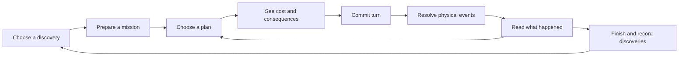

# ASTRIX: turn-based exploration revision

**Status: approved for implementation. Execution and integrated verification are in progress.**

The user approved thorough implementation of this revision, including a clear Design & Play path, full typecheck/test/build and production multiplayer verification. It supersedes [the previous plan](./MISSION_DESIGN_COMPLETION_PLAN.md). Historical status and proposed usability targets below are not claims of current verification. Human enjoyment/comprehension testing remains distinct from browser automation.

## 1. Status at the pause

- The latest completed `bun run typecheck` passed. A subsequent room regression-test edit has not been typechecked.
- The integrated `bun test` run reported **381 passed, 24 failed across 405 tests / 58 files**. Changes after that run are unverified, not deducted from the failure count.
- Failures include custom-definition publication/import/setup, ascent recommendations and launch readiness, lunar conic propagation, JSON-safe snapshots, objective/crew reporting, translation/help coverage and obsolete contract assertions.
- The host frame-limit test was updated and malformed-definition room-continuity coverage was added after the run; neither is verified yet.
- The combined production build, real browser workflows and final-build LAN rehearsal remain outstanding. Earlier verification applies only to the earlier recorded builds.
- Canonical overview/NASA-resource documentation and the previous completion plan exist. Source implementation is substantial but **not release-ready**.

The status above records the pre-approval baseline. Implementation is now authorized; retained scientific contracts remain requirements during the cutover.

## 2. Product decision

**Make ASTRIX a fun learning game about exploring space and making consequential choices—not a full-blown mission design studio.** The user's clarification supersedes the earlier requirement for an unrestricted Expert authoring experience. Keep GMAT support as an optional scientific bridge.

Recommended model: **decision-based turns with a scientific simulation underneath**. Both Aspiring and Expert use the same legible loop. Expert adds harder tradeoffs, not more mandatory controls.

A turn is one commitment until the next meaningful decision, not a fixed number of seconds and not an arbitrary action-point currency. The UI states the expected elapsed mission time. A launch may cover minutes; an orbital observation a pass; a transfer several days. The engine still resolves intervening fuel, power, communications and hazards.

### Considered alternatives

| Direction | Benefit | Problem | Recommendation |
|---|---|---|---|
| Keep real time; hide more panels | Least engine change | Timing, command sequencing and workflow burden remain | Reject as the main revision |
| Fixed-duration turns | Simple clock rule | Ascent, orbital passes and interplanetary coast need very different scales; creates empty turns | Reject as universal rule |
| Decision-based turns | Concentrates play on mission choices; reuses physics | Requires reliable event boundaries and preview/commit contracts | Adopt |
| Abstract board game with dice/resource tokens | Easier to author and balance | Replaces much of the scientific model; risks detached outcomes | Do not adopt for this revision |

This is a gameplay replacement, not an additional mode beside the old real-time experience. Keep visual playback; remove the need to manage simulation speed.

**User clarification during implementation:** keep the 3D space scene visible at all times. Mission selection, quick design, turns and debrief are contextual panels over the persistent scene, not a document form with an optional 3D illustration. Keep plan-action toggles visible at the bottom or beside the turn panels. Camera, component inspection and rendering remain presentation-only; selecting a plan still previews rather than commits.

Mission display names must explain destination, operation and purpose in both languages. Stable IDs and saved identity remain unchanged; ambition-dependent numerical targets come from the actual definition rather than fixed numbers in a display name.

## 3. Research and what it changes

These sources establish precedents and design guidance, not evidence that our proposed game is usable. We have not playtested these games or the proposed ASTRIX flow in this research pass.

| Source | Observed principle | ASTRIX application / limit |
|---|---|---|
| [NASA Webb Build It Yourself](https://science.nasa.gov/mission/webb/game-build-it-yourself/) | Science goals drive instrument/engineering choices; smaller levels bound choices; choices remain editable before launch | Start with the discovery goal; present a small set of consequential equipment choices. Do not copy its stated phone/accessibility limitations. |
| [Mars Horizon launch guidance and game description](https://news.xbox.com/en-us/2020/11/17/7-tips-run-your-own-space-agency-mars-horizon/) | Turn-based mission control, adjustable difficulty, launch timing and optional objectives make resource tradeoffs strategic | Adopt mission decisions, optional stretch goals and readable difficulty. Do not import agency management, contractors, diplomacy or a large tech tree. ESA/UK Space Agency collaboration belongs to that game, not ASTRIX. |
| [Into the Breach developer description](https://subsetgames.com/itb.html) | Developer search results describe telegraphed attacks and deliberate turn-based counterplay | Reveal predictable hazards and consequences before committing. This is an analogy, not permission to promise perfect knowledge of scientific uncertainty. Direct page retrieval returned HTTP 403; this source was available through search indexing only. |
| [NN/g: Progressive Disclosure](https://www.nngroup.com/articles/progressive-disclosure/) | Primary options first; specialized controls on request; experts also benefit; excessive disclosure depth and interdependent wizards cause friction | One decision surface and one technical-detail layer. Keep coupled design choices together rather than splitting them into many approvals/screens. |

**Diagnosis:** the user report is the usability evidence. Source inspection supports a structural explanation: `MissionControl.tsx` simultaneously coordinates chapters, stage/substep selection, trays, floating panels, checklists, forecast controls and multiple pause/advance actions. Simplifying labels alone does not remove those decisions. No new browser observation is claimed here.

## 4. The new player loop

### Explore

A small destination atlas replaces the front-loaded Learn/Challenge/Create decision tree. Earth, Moon and Mars show a small board of distinct ready-made missions and a first-class **Design & Play** action. Each brief explains what can be discovered and approximate play length. The list is equally usable without the 3D scene. First entry highlights one short Earth mission; users can design their own without navigating a separate studio.

A discovery journal records completed objectives and explains the real-world science connection. These are game achievements from simulated observations, never claims that the player collected new NASA data. No spendable science currency, grinding or branching technology tree in this revision. Recommended sequencing is guidance, not a forced grind to reach the Moon.

### Prepare

One preparation workspace supports ready-made missions and quick creation through the same rules:

1. **Destination and goal:** choose a compatible objective family and see its success condition.
2. **Ambition:** select a bounded target band; the actual target, budget allowance and deadline are visible.
3. **Mission kit:** compare a few spacecraft/launcher packages and meaningful upgrades.
4. **Approach:** select a compatible route/operations plan with visible reserve-versus-output consequences.
5. **Play mission:** freeze the checked configuration and begin the real attempt. Naming, saving, sharing and publishing are not prerequisites.

Packages are explicit configurations of real catalogue items; they cannot invent free hardware or hide incompatibilities. Players choose a few understandable upgrades, not assemble every subsystem. Details explain the configuration and its tradeoffs; they are not a relocated full engineering editor. No mandatory freeze/signoff/requirements ceremony in solo play; compute validation automatically and explain only blockers relevant to the choice.

### Quick design, real constraints

The [deeper Void Protocol research](../research/void-protocol-gameplay-lessons.md) replaces “optional remix” with first-class quick mission creation for both levels. Borrow its small mission board, typed objectives, tangible loadout tradeoffs, concrete progress, discovery payoff and same-seed replay—not its industrial economy or interface complexity.

Start from a viable configuration, not a blank form. Changes update one live brief containing goal, restrictions, cost/fit and the dominant resource bottleneck. Budget allowances never silently increase with ambition; no automatic repair changes the player's target, equipment or constraints without explicit acceptance.

Separate **compatible**, **within limits**, **checking**, **no viable plan found**, **Ready** and **Stretched** states. Static validation alone does not establish playability. A Ready mission requires a successful reference policy under its nominal model, using the same engine as play. This establishes a feasible path, not guaranteed player success or a calibrated probability.

Use bounded, tested template/kit/route combinations rather than an unrestricted solver. Cache checks by complete definition, configuration, policy, seed and rules/model identity; invalidate stale results. Checking timeouts are not proof of impossibility. Rate challenge from measured reserve/time slack, decision demands and authored hazards, with visible reasons. Tune bands with combination sweeps and human playtests, not invented NASA authority.

Require multiple meaningfully different viable approaches per core family. Check for a dominant loadout, trivial maximum-ambition wins and empty repetitive turns. Bigger payloads must consume real mass/power/budget; lower ambition cannot earn arbitrary high-tier rewards. Curated and player-designed missions use the same turn, objective and debrief contracts.

### Decide and resolve

Each decision shows: **where we are; what we want; what happens next; two to four relevant options; one commit button**. Routine instrument activation, pointing, contact scheduling and command sequencing become declared operational plans, not separate compulsory clicks.

Selecting an option previews resource deltas, elapsed time, objective effect and the next stopping point. Selecting does not execute. The commit label names the action, such as “Observe this pass” or “Begin lunar transfer,” rather than an ambiguous “Continue.”

Resolution produces a short receipt: what changed, why it changed and what can be done next. Optional animation illustrates the resolved flight and can be skipped without altering the result. Idle time, open Help and browser backgrounding never consume a game turn.

## 5. Simplify both levels

| Area | Aspiring | Expert |
|---|---|---|
| Core interaction | Same turn-based loop | Same turn-based loop |
| Preparation | Recommended package and bounded alternatives | More competing package/upgrade choices and optional stretch objectives |
| Assistance | Recommended action with a reason | Optional comparison; no compulsory recommendation |
| Constraints | More forgiving, explicitly labelled margins | Tighter budgets, competing objectives and disclosed uncertainty |
| Flight operations | High-level plans | High-level plans with harder resource and route tradeoffs |
| Information | Plain-language effects; units in Details | Same readable overview; exact units and assumptions on demand |
| Mistakes | Explicit retry from a decision checkpoint, marked assisted | Restart/branch as a separate attempt; no silent outcome reroll |

Difficulty must never be implemented by hiding required information, adding paperwork or requiring real-time reactions. Both levels need valid starting designs and explainable failure.

### Complexity budget (proposed acceptance constraints)

- At most four primary action choices at one decision; more configurations belong to comparison/Details.
- One primary commit action, no competing pause/resume/advance/go buttons.
- No more than three resource indicators in the normal decision view, selected by relevance; every imminent failure condition must surface regardless of that limit.
- Always show the objective and elapsed mission time separately from those indicators.
- Use Fuel, Energy and Data where relevant; preparation emphasizes Cost and Fit. Crew support, thermal and radiation details surface when relevant, never disappear from the model.
- No compulsory full-screen tutorial chain. Teach the first three decisions inline; preserve Help replay and opt-out. The existing 15-card limit becomes a ceiling, not a content quota.
- No numeric orbital-element, PID, attitude or burn-vector entry required to complete a built-in mission at either level.

### What makes it fun

- **Anticipation:** choose an interesting question before choosing equipment—what can we learn from this orbit or destination?
- **Agency:** offer different viable approaches, not one correct button plus obvious mistakes. A fast flyby and a longer orbital survey can produce different useful discoveries.
- **Payoff:** each resolved turn reveals a visible consequence: launch, a changed orbit, an observation, a transmitted finding or a recoverable setback. Couple a short explanation to that payoff rather than interrupting it with a lecture.
- **Experimentation:** make retrying a different decision quick and preserve the previous outcome for comparison. Failure teaches a cause, not a checklist.
- **Discovery:** journal entries combine a simulated result with an attributed real image/fact or mission comparison; never misrepresent archival material as a newly acquired observation.
- **Replay:** vary goals and resource tradeoffs within supported missions. No grind, forced streaks, repetitive maintenance turns or new agency economy.

These are design hypotheses to test. Completing a task is insufficient if players find the choices dull or cannot name something they learned. Ask playtesters what they would try differently and whether they want another mission.

## 6. Example: an Earth-to-Moon mission

The following is a proposed decision sequence, not a verified flight or fixed story script:

1. **Choose the question:** return lunar observation data; optional stretch goal preserves a fuel reserve.
2. **Prepare:** compare an economical orbiter and a higher-endurance configuration, with actual equipment/budget differences.
3. **Launch:** choose the validated launch plan; resolve powered ascent to parking orbit or an actual failure boundary.
4. **Depart:** compare transfer plans by duration, predicted encounter and fuel reserve; commit the chosen plan.
5. **Approach:** inspect measured trajectory against forecast; correct if needed, accept a flyby, or attempt capture where physically feasible.
6. **Capture:** resolve the burn. Entering the Moon's sphere of influence alone never counts as orbit insertion.
7. **Observe:** choose observation versus recharge/coast according to the present opportunity and available resources.
8. **Return data:** transmit at a feasible opportunity or continue observations for an explicit stretch objective.
9. **Debrief:** record achieved evidence, misses and the design decision with the largest consequence.

The game may need extra decisions for hazards or repeated observation opportunities; it must not force this outline onto failed or materially different trajectories. A safe flyby can be a useful discovery without falsely satisfying an orbital objective.

## 7. Scientific and turn-resolution contract

Keep the core as the sole rules authority. The renderer never decides success. Reuse definitions, validation, physical propagation, finite inventories, evidence, provenance and verified reference cases.

Proposed session contract:

- A decision has a stable ID, state revision, allowed plans and an expected next boundary.
- Preview uses an immutable starting state and the same resolution code as commit; it does not consume random state, mutate prediction caches or advance the real session.
- Commit includes decision ID, base revision and an idempotency key. Stale/double commits cannot advance twice.
- Resolve in deterministic event order through command arrival/execution, resource changes and trajectory boundaries. Stop at the next required decision, terminal event or declared plan completion, whichever comes first.
- Simultaneous events have specified precedence. A deadline or failure cannot be skipped because a planned maneuver happens at the same time.
- Unexpected material changes interrupt the plan and create a new decision; do not auto-select a dangerous continuation.
- Every nonterminal decision has at least one meaningful feasible action, including an explicit end/abort where physical continuation is impossible. Waiting must advance to a genuine opportunity; no zero-time infinite turn loop.
- Publish resolved state and its receipt atomically. Chunk heavy work without publishing half a turn; show a bounded resolving state. Technical resolution errors leave the last committed state intact and are not reported as physical mission failures.
- When uncertainty is modelled, show ranges and their authored/source basis. Do not invent percentage success odds or hide a predetermined outcome behind a misleading preview.

No universal “repair antenna” action without hardware and an existing supported procedure. No instant recharge, arbitrary data conversion, free burns or magic capture. Simplification changes the player's decisions and automation level, not conservation laws.

### Save and multiplayer

A turn-based game needs reliable return-to-play. Add a versioned save at committed decision boundaries for local play, including definition identity, simulation state, turn history and reproducible random state. Preserve the previous valid save if writing fails; disclose failure. Corrupt/incompatible saves offer explanation/export rather than silent reset. Old definitions may migrate only through explicit validated conversion; old active flights and scores are not relabelled under new rules.

For LAN, keep one Bun authority. Replace wall-clock flight advancement with explicit turn commits; retain networking heartbeat/expiry clocks. Shared-screen discussion and optional phone proposals feed one host commitment. No per-turn unanimous Ready/signoff requirement; it would reproduce the bureaucracy being removed. Disconnects never auto-commit or start a local simulation. Version the protocol and rules at the cutover. Whether host restart recovery is included is an explicit review decision; do not imply it from local saves.

### GMAT support stays

Keep a clearly labelled optional **GMAT tools** entry reachable from the mission menu and debrief, outside the ordinary play loop:

- Preserve the existing bounded, inert GMAT initial-state import/export and supported sampled-trajectory/OEM inspection. Do not execute uploaded scripts.
- Keep frames, epochs, units and supported-body restrictions explicit. Current unsupported lunar interchange remains a clear refusal unless separately implemented and verified; the lunar game does not imply full GMAT lunar export.
- Imported trajectories remain view/reference data, not fabricated resource histories, completed objectives or scored flights. A supported imported initial state can become a new compatible mission setup only through validation and explicit confirmation.
- Export supported initial conditions and retain external GMAT reference scripts for independent comparisons. Do not label an initial-state export a full mission or maneuver-sequence export.
- Preserve provenance and the distinction between game physics, GMAT output and comparison results. No GMAT installation is required to play.
- Include supported import/export round trips, unsupported-file refusals, trajectory viewing and a real GMAT reference comparison in final verification.

Keep underlying mission definitions as engine/content structures. **Design & Play** is a primary game action for both levels: choose a destination-compatible goal, ambition, kit and approach, check the constraints, then fly. Arbitrary schema editing, subsystem configuration and a general-purpose studio remain excluded—not hidden behind Expert.

## 8. Keep, replace and stop expanding

| Existing work | Proposed disposition |
|---|---|
| NASA/data attribution, measured profiles, constants, GMAT references | Keep; preserve scope qualifications |
| Definition validation/digests, saved definitions | Keep necessary internal/content and save integrity; adapt supported saved content explicitly |
| Ascent, conics, fuel, data and objective evidence | Keep where correct; fix independently before trusting turn previews |
| Scene, spacecraft models and trajectory playback | Keep as exploration context and consequence visualization; not required input |
| Seven stages, chapter selector, repeated readiness/signoff workflow | Replace the player-facing journey; remove obsolete requirements/callers during cutover |
| Speed controls, pause stack, manual routine command choreography | Remove from normal gameplay; replace with plans and decision boundaries |
| Floating-window dashboard as default | Replace with one stable mission workspace and one Details layer |
| Existing short missions and four challenges | Adapt to the same loop; do not maintain a second legacy runtime |
| Fifteen concept cards | Reuse relevant explanations; stop treating fifteen interruptions as the target |
| Full raw Expert authoring form and general-purpose studio | Replace with first-class, bounded Design & Play for both levels; validate real constraints and a feasible path |
| GMAT import/export, trajectory viewer and external reference workflow | Retain as optional scientific tools with existing explicit format/body limits |
| Agency economy, tech tree, combat, colonization, landings, new planets | Do not add in this revision |

The old tests are not all disposable. Conservation, replay, authorization, objective truth and provenance remain requirements. Tests that only pin removed workflows must be replaced by turn contracts, not mechanically translated into new ceremonial steps.

## 9. Implementation order after approval

### Gate A — validate the playable concept before rebuilding the product

Create a disposable interactive prototype covering mission offers → quick design → consequence preview → turn-based play → discovery/debrief → changed-design retry. Use one Earth observation family and the lunar decision sequence. Include at least two viable approaches, a constraint conflict and a recoverable mistake. Label prototype calculations as illustrative; do not pass them off as engine proof. Test with novice and technically experienced players. Review this complete loop before broad migration.

**Exit:** users can identify the objective, predict the main consequence and commit a turn without facilitator instructions. Revise the loop if they cannot; do not compensate with longer tutorials.

### Gate B — repair the foundations the new loop retains

Triage the 24 observed failures by retained contract versus superseded workflow. Repair JSON-safe snapshots and preview purity, definition/copy/import contracts, real objective units, ascent feasibility and conic robustness. Complete bilingual scientific context coverage. Verify malformed input cannot kill a room or erase credentials. Keep GMAT comparisons separate from full mission validation.

**Exit:** retained behavioral tests pass and the simulation supplies truthful, replayable initial states and forecasts. Do not spend this gate polishing obsolete real-time controls.

### Gate C — build one complete turn-based mission

Implement decision/plan/preview/commit/receipt contracts in core/session; adapt static and LAN authority; add decision-boundary saving. Build quick creation and the decision workspace around the First Signal family, with bounded goal/kit choices, real feasibility checks and at least two viable approaches. Prove the full path with real engine outcomes, constraint refusals, reload, retry and debrief before expanding content.

**Exit:** one mission is genuinely playable, not a mock or a parallel legacy mode. Duplicate commits, stale choices, preview mutation and lost saves have meaningful regression coverage.

### Gate D — adapt the full approved content

Adapt suborbital/orbit/maneuver lessons, the four original challenges and Earth-to-Moon launch through data return to generated/validated decisions. Add the small mission board/atlas, discovery journal and Design & Play support for compatible mission families. Verify both levels through the same interface. Sweep supported configurations, record reference successes and measured margins, and test for dominant choices and decision dead ends. Preserve existing saved user work through explicit migration or export.

**Exit:** each mission has a valid opening, meaningful tradeoffs, truthful success/failure and no mandatory raw engineering input. The explicit scope reduction is the general-purpose design studio, following the user's clarification; GMAT support remains.

### Gate E — cut over and verify the actual experience

Remove obsolete workflow controls, full-studio surfaces, clock entry points, translations and tests once their replacement works. Do not ship permanent compatibility shims or two competing authorities. Run typecheck, retained/new tests and production build; verify actual desktop/compact surfaces, keyboard use, reduced motion and both languages. Exercise real HTTP/WebSocket clients with `bun run host`, disconnect/reconnect and stale/double commits. Verify the retained GMAT tools separately. State physical-phone limits separately.

**Exit:** production play and LAN share the same deterministic turn outcomes; the UI no longer exposes the old workflow accidentally.

### Gate F — final evidence and documentation

Update canonical missions, simulation, architecture, UI, multiplayer, resource and verification pages to describe the verified cutover. Reconcile challenge acceptance, credits, changelog and delivery report. Validate links, regenerate public documentation and remove prototype/proof services. No “ready” claim while retained content or accessibility paths are broken.

## 10. Proposed playability acceptance

These are targets for review, not observed results or universal research thresholds:

- First meaningful choice within one minute; first resolved outcome within three minutes, without mandatory documentation.
- First Earth mission aims for 5–10 minutes and 4–6 substantive decisions; lunar mission aims for 15–25 minutes and roughly 8–12 decisions. Tune from playtests, not by inserting filler or skipping physics.
- In an initial formative study, recruit at least five unfamiliar players plus technically experienced participants; record assistance, wrong turns, abandonment and comprehension rather than only completion.
- At least four of five unfamiliar players should complete the first mission without facilitator intervention and explain one equipment/resource tradeoff. This is an initial release gate, not statistical proof of broad usability.
- A first-time player can design and start a mission in roughly two minutes; record computation latency separately. This is a proposed usability target, not a current measurement.
- Every shipped Ready configuration has a reproducible reference success. Goal/loadout/constraint changes invalidate the proof and materially change the mission where expected.
- Each core family supports at least two meaningfully different viable approaches. Players can explain their tradeoff and name a different design they want to try.
- Mission completion must deliver a satisfying discovery or consequence, not merely a score. Ask about enjoyment and replay intent alongside task completion.
- At every decision a player can answer “What am I trying to do?”, “What can I choose?” and “What will this cost or risk?”
- No losses while reading/thinking; no unresolved turn after reconnect; no scene-only controls; no false success or silently discarded draft/save.
- A failure receipt identifies the physical/strategic cause and a possible changed decision, rather than dumping raw telemetry.
- Real browser automation can prove functionality, not approachability. If human playtesting cannot be arranged, report usability as unverified rather than replacing it with scripted clicks.

## 11. Review decisions

Recommended approval package:

1. **Decision-based turns replace real-time play for both levels**, with physics retained underneath.
2. **First-class Design & Play for both levels:** a few goal/ambition/kit/approach choices, real constraints and checked feasibility, replacing the full studio and stage/signoff ceremony.
3. **A small mission board/atlas, discovery journal and same-seed retries**, borrowing VP's goal–commitment–payoff loop without its empire economy.
4. **Local decision-boundary saves are required**; LAN remains one host authority. Host restart persistence needs an explicit scope decision.
5. **GMAT support remains optional and functional**, with honest interchange/validation limits.
6. **Enjoyment and player-comprehension evaluation remain required evidence.** Execution is approved; automated browser verification establishes functionality, not human usability or enjoyment.

## 12. Finalization sequence after the session recap

The owner requested a full session recap and finalizing plan. Implementation is paused for that report, not declared release-complete.

### Observed state

- Latest full integrated suite: 425 passed, zero failed, 52 files, 55,075 assertions. Later component-picker/detail refinements have typecheck/build and partial browser evidence, not a new full-suite result.
- Latest typecheck passed. Latest production build passed with 2,841 modules and existing >500 kB chunk warnings.
- Production HTTP/WebSocket host/controller checks passed for protocol 3: admission, roles, proposals, host-only commits, duplicates, stale requests, reconnects and frozen idle mission time. The final subsequent change was detail-panel CSS; physical phones remain untested.
- Browser evidence includes real Earth/Moon textures, seven persistent resource cells, collapsed-panel action availability, modal cancellation/focus return and explicit replacement, localized component options at 320 px, keyboard component inspection and dismissible spotlights.
- A production `removeChild` exception was recorded during the earlier component/scene walkthrough. Its root cause is not established; subsequent interactions without a new exception do not resolve it.
- A global definition-list grid compressed component specification rows. The local one-column grid fix is built, but its final visual check was interrupted.
- The latest reload at `#play` shows no active attempt and a Mission board action. The explicit saved-mission resume path has not yet been completed on that build; this observation alone does not establish lost save data.

### Ordered closing gates

1. **Resolve the known renderer lifecycle error.** Trace the recorded DOM ownership/unmount failure around HTML scene overlays and component selection. Fix the cause, cover the affected lifecycle and verify selection, close, destination changes and reload without losing the scene.
2. **Finish component inspection proof.** Inspect the corrected detail rows and custom icon/title/description picker at desktop and 320 px, in both languages. Check keyboard movement/selection, Escape and outside dismissal, focus return, overflow, readable descriptions and unchanged mission state.
3. **Complete the final player journey.** Landing → optional lesson/skip → solar exploration → mission board → constrained design → preview/commit → debrief/journal → reload/resume → same-condition retry. Verify one retained Canvas, resource/action visibility, actual planet textures, preserved camera angle/zoom and meaningful refusals. Include compact, keyboard and reduced-motion paths.
4. **Close retained scientific and content acceptance.** Preserve the recorded 648-configuration balance sweep and independent GMAT residuals. Exercise representative ascent, maneuver, lunar and crew paths through the final UI; repeat numerical checks only if their implementation changes. Do not equate nominal feasibility with human playability.
5. **Freeze source and verify one production artifact.** Run the requested final typecheck/tests/build after actual remaining fixes. Start the host against that exact artifact and complete browser lobby/controller/proposal/commit/reconnect checks. Keep desktop clients distinct from real-device qualification.
6. **Finalize canonical documentation and evidence.** Reconcile stale integration-pending text in INDEX, VERIFICATION, CHANGELOG and affected canonical pages. Record actual build/check boundaries, screenshots, remaining warnings, source attribution and unsupported capabilities. Check documentation links and refresh public copies.
7. **Close the delivery environment.** Remove assistant-created throwaway proof files and stop obsolete preview services, preserving any explicitly wanted preview. Provide launch commands and a concise acceptance report. Physical-phone testing, independent language/science review and novice enjoyment/comprehension studies remain separate evidence requirements.

No new gameplay systems, raw authoring studio or additional mission destinations are added during finalization.
