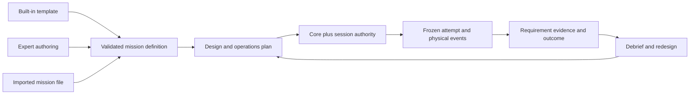

# From preset missions to a mission-design studio

## Status and decision

Research and recommendations only. No runtime changes or new verification passes are claimed. The user's reported 97-step tour is accepted as the observed experience; no reproduction run was needed. Repository source, current canonical documents, three focused research investigations, NASA references, learning research and Impeccable onboarding guidance informed this report.

**Recommendation: make custom mission design the product's center, use authored missions as editable examples, and teach through short real missions rather than exhaustive interface tours.** Implement a common mission-definition/evidence model first; build launch, maneuvers and the lunar mission on that foundation. Independently reduce onboarding to **15 concept cards across the entire first mission**, not 15 cards for each of six automatically chained tours.

“Full mission design” should mean control over the objective, measurable success criteria, vehicle, launch, trajectory, operations, constraints and evaluation—not unlimited fictional physics. Supported capabilities must be composable; unsupported capabilities must be explicitly unavailable rather than simulated by labels.

## 1. Diagnosis: what exists and what is missing

| Concern | Current implementation | Product consequence |
|---|---|---|
| Expert | Harder engineering profile, technical constraints and different budget factor | It does not let the player author a mission |
| Mission identity | Four closed scenario IDs; Earth and Mars only | Destination, goal, payload and outcome remain preset |
| Objectives | One main target using delivered MB or radiation-monitor hours; additional crew evidence | Orbit acquisition, escape and lunar capture cannot be expressed as ordinary missions |
| Mission process | Objective confirmation, segment choices, trade, baseline, verification, role approvals | Useful process, but confirming an authored objective is not defining one |
| Launch | Six-second presentation storyboard; simulation starts from an authored orbit | Launch visuals cannot prove a successful ascent |
| Trajectory | Bound elliptical propagation; Mars-specific analytical transfer/capture | No general burns, Earth escape, lunar encounter or Moon-relative orbit |
| Tours | Repeated control inventories plus dynamically added checklist/part/evidence steps | More hardware or detail produces more onboarding, not better conceptual learning |
| Custom persistence | Preferences, setup selection and preset best scores; no definition library | A user cannot save, exchange or reproduce a self-authored mission |

### Concrete source evidence

- [Core contracts](../../packages/core/src/contracts.ts), lines 2–4, 33–37, 49 and 80: closed identities, two objective metrics, scenario-linked Design, no general burn command, no custom content identity in results.
- [Catalogue](../../packages/core/src/catalog.ts), lines 79–110: fixed rides/scenarios and starter choices; `scenarioById` assumes successful catalogue lookup.
- [Journey](../../packages/core/src/journey.ts), lines 21–51: fixed requirement rows and mandatory trade/baseline/verification. Scientific quality is correctly retained as `NOT_EVALUATED`.
- [Scoring](../../packages/core/src/score.ts), lines 10–26: primary success depends on the scenario's single objective; an explicitly ended session is failure.
- [Physics](../../packages/core/src/physics.ts), lines 22–24 and 103–119: ellipse-only solver and Earth–Mars-specific transfer/capture helpers.
- [Scene registry](../../apps/web/src/three/missionScenes.ts), lines 20–42: visual selection also depends on the four fixed identities and Mars-specific transfer rules.
- [Setup](../../apps/web/src/ui/screens/Wizard.tsx), lines 8–18 and 33–42: stores a catalogue choice, not a mission definition.
- [Tour generation](../../apps/web/src/ui/tour/tours.ts), lines 13–85: enumerates chapters, substeps, panels, resources, camera actions, hardware categories, commands, pilot axes and warp speeds; repeats those arrays and appends dynamic content.

The existing graph was useful for discovery but predates parts of the latest implementation; current source, not graph edges, was used for these conclusions. No language server was configured. The historical Moon entries in [Missions](../MISSIONS.md) are explicitly proposals. Its old expansion-tier table also still says “three playable missions” and lists thermal work as future despite the current four-mission/thermal implementation: treat that table as historical, not a current capability registry.

## 2. Product structure: Learn, Challenges, Create

Use three entry choices within the existing setup language, not three separate applications:

- **Learn:** short, focused missions with a small number of meaningful decisions, optional worked examples and contextual guidance.
- **Challenges:** the existing missions and future authored challenges, with explicit constraints and comparable results.
- **Create:** Expert's primary path. Start blank, duplicate a challenge or continue a saved design. Presets are examples, not a prerequisite or unlock gate.

Keep **mission origin**, **difficulty/engineering profile** and **help depth** separate. Expert must expose Create immediately, as requested, while retaining access to all presets. Do not make players endure random faults to gain authoring access, or make hiding explanations change physics. Initially the full editor can be Expert-only without encoding that UI restriction into the mission format. A future guided editor can use the same definitions.

Keep the bottom MissionControl as the operating center. Its primary action should resolve the next meaningful unresolved design decision rather than merely advancing through mandatory paperwork. Expert may navigate and revise prelaunch work freely; actual freeze, validation, permissions and launch guards remain authoritative.

### The first-value moment

The first useful experience is not “I have seen every button.” It is: **“I changed a design choice, saw its cost, flew it and understood the result.”** For a beginner this might be delivering one small product after balancing battery and downlink. For an Expert it is creating a measurable mission that did not exist in the catalogue.

NASA's [Webb Build It Yourself](https://science.nasa.gov/mission/webb/game-build-it-yourself/) is a relevant precedent: science choices drive instruments and engineering, and scientifically invalid combinations remain unavailable. Its accessibility and phone limitations are not patterns to copy. NASA's [Design and Develop Science Missions](https://www.nasa.gov/wp-content/uploads/2025/04/250323-design-and-develop-science-mission.pdf), pages 8–19, supports the four segments and the objective→requirements→verification flow—not a demand that every beginner click through every process stage.

## 3. Expert custom missions: what genuine authoring requires

### 3.1 Authorable decisions

| Design area | Player control | Evidence that it is real |
|---|---|---|
| Purpose | Name, brief, target body and mission type | Purpose is linked to executable criteria, not just displayed text |
| Success | Typed objectives, thresholds, units, deadlines, required versus optional criteria | Actual telemetry/events determine results |
| Constraints | Budget, duration, starting conditions, vehicle envelope, allowed services and environmental profile | Quotes, readiness and operations enforce them |
| Spacecraft | Bus, instruments, power, storage, radio, attitude, propulsion and applicable support systems | Existing coupled mass/power/data/fuel consequences remain |
| Launch | Ride or modeled vehicle, departure site/time and parking-orbit target within supported capabilities | Capacity/cost or integrated ascent determines delivered state |
| Trajectory | Initial orbit, ordered maneuver/coast/encounter/capture plan | Forecast and flown state use the same model |
| Operations | Ground service, instrument strategy, supported scheduled actions and duration | Commands obey fuel, geometry, transport and ownership |
| Evaluation | Required success conditions and a supported rubric | Report distinguishes achieved, failed, incomplete and not evaluated |
| Reuse | Save, duplicate, export and import a definition/design | A saved mission recreates the same specification and version identity |

Do not expose imaginary resolution, coverage, landing accuracy or stationkeeping performance until evaluators exist. Free-text aspirations can be recorded as explanatory notes, but must not count as demonstrated success. Distinguish “not modeled” from “not yet achieved.”

### 3.2 Recommended architecture

Introduce one bounded, declarative **MissionDefinition**, used by both built-in and custom content. Keep three concepts distinct:

1. **Definition:** what the mission asks and permits.
2. **Design and operations plan:** how the player proposes to meet it.
3. **Attempt:** immutable frozen inputs plus actual state, events and outcomes.

A definition needs schema version, authoring ID/revision, content digest, provenance, supported environment/phase sequence, design envelope, objectives, constraints, outcome policy and presentation metadata. Its evaluator vocabulary should be a closed typed registry, not executable user code or a generic expression language.

Useful evaluator families include delivered qualifying product; measured operating time in a declared interval; orbital apsides/shape within tolerance; actual encounter distance; capture into a bound non-impacting orbit; survival/resource margin over an interval; and applicable return/support completion. Add each only alongside its physical evidence producer.

Do not store a single `CUSTOM` ID whose meaning is whatever happens to be in localStorage. Freeze the complete validated definition into the attempt, or an immutable content-addressed representation that is guaranteed available. All four built-ins should become ordinary definitions without losing their authored identity.

### 3.3 Requirements and outcomes

Follow a small playable version of NASA's [Science Traceability Matrix](https://hesto.smce.nasa.gov/focused-topics/): **purpose → observable result → required capability → design choice → evidence**. Avoid reproducing a professional spreadsheet as the default interface.

For each objective show its target, actual value, unit, owner, evidence source, evaluation interval and whether it determines success. A mission can have several required objectives plus optional stretch goals. Do not hide a failed required objective inside a high weighted average.

Separate the **hard execution envelope** from **mission performance goals**. Invalid state, impossible hardware placement and unsupported configurations are blockers. A plausible but underpowered or overambitious experiment can be forecast as likely to fail; an explicitly marked experimental run may be useful in Create, rather than guaranteeing success by refusing every risky design. Any override must be a defined authority policy, not a client-side bypass, and excluded from comparable challenge scores.

Success, termination and scoring also need separation. A short orbit lesson should finish when its declared terminal criteria are satisfied; it should not require running a 14-day clock or pressing today's failure-classifying End mission. Other objectives require dwell time or a completed return and must not finish on a momentary threshold crossing.

### 3.4 Persistence, comparison and multiplayer

- Save drafts and immutable published revisions separately. Local saving is not the same as restoring a running flight. Provide JSON export/import so a custom mission is not trapped on one browser; show storage failures instead of claiming a save succeeded.
- A run identity must include definition digest, schema/model/catalogue versions, level, seed, assistance, frozen design and relevant execution policy. A digest identifies content; it does not prove trustworthy authorship.
- Best scores compare only equivalent definitions and policies. A custom target of one byte or a huge budget must not outrank a constrained built-in challenge. Prefer evidence and improvement against one's own prior revision to a universal custom-mission leaderboard.
- Changing an objective or constraint before launch creates a revision and invalidates dependent evidence, approvals, quotes and forecasts. Changing it after launch creates another attempt. No moving the goalposts to rescue a flight.
- LAN host/import administration must not grant ownership of every engineering discipline. Definition edits need explicit authoring permissions and stale-revision rejection; design and command permissions remain role-owned.
- Extend strict session validation, public snapshots and protocol versioning. The current host frame bound is 8,192 bytes; choose a documented bounded definition transfer rather than silently exceeding it. Validate size/count/depth, finite numbers, units, reference IDs, epochs, phase compatibility and evaluator applicability. Imported content must never run scripts or fetch arbitrary dependencies.
- Current bounded session replay is a checkpoint plus suffix, not an unlimited archive. Exported run/replay claims must include the required baseline and pinned definition; a public snapshot alone is insufficient.

**Migration choice:** convert the four existing presets to the common representation, retain their numerical behavior where the model is unchanged, and remove old scenario-name dispatch from each migrated consumer. New launch/trajectory semantics warrant an explicit rules/model version. Preserve old bests as historical; reject unsupported old active snapshots explicitly rather than relabeling them. Do not retain a parallel mutable custom engine beside the preset engine.

## 4. Simpler missions: teach concepts, not smaller data quotas

“Getting out of orbit” can mean deorbiting, changing orbit, escaping Earth, or simply reaching space. These should be separate named lessons. NASA's [Flight to Orbit](https://www1.grc.nasa.gov/beginners-guide-to-aeronautics/flight-to-orbit/) explicitly distinguishes altitude from the horizontal velocity needed for orbital flight.

### Recommended learning ladder

| Mission | One principal decision | Observable success | New capability needed |
|---|---|---|---|
| **First Signal** | Support one useful observation with power, storage and radio | A declared small amount of qualifying product reaches Earth | Short composable objective/termination; existing operations largely reusable |
| **Up and Back** | Choose thrust/cutoff to reach a target apogee | Target band reached, then declared return boundary crossed | Powered suborbital dynamics; not a landing claim |
| **Stay in Orbit** | Build sideways velocity, not just height | Bound orbit, periapsis above declared atmospheric boundary and target shape within tolerance | Physical ascent/insertion and orbit evidence |
| **Raise Your Orbit** | Burn at the right place, then circularize | Both apsides within target bands and propellant accounted | General maneuver planning/execution |
| **Leave Orbit Safely** | Lower periapsis with a retrograde burn | Cross the declared entry interface | Deorbit evaluator; no fabricated thermal-entry or landing success |
| **Past Earth** — optional branch | Add enough energy for departure | Outbound, non-impacting trajectory meeting the chosen two-body escape criterion | Open-conic propagation and energy evidence |
| **Meet the Moon** | Time departure to meet a moving target | Actual Moon-relative closest approach in the target band | Moving Moon, encounter targeting and frames |
| **Earth to Moon: First Lunar Mission** | Reserve enough capability to arrive, capture and return a product | Complete ascent, transfer, bound lunar orbit and product return | Integrated lunar capability described below |

First Signal is a quick systems-design success; Up and Back begins the physical flight sequence. Earth escape is an optional conceptual branch, **not a prerequisite for the Moon**: a translunar transfer can still be bound in an Earth-centered two-body description.

Each learning mission should ship with a documented starter vehicle, explicit precompleted work and only the relevant editable decisions. A practice starting in orbit should say “Provided parking orbit,” not pretend the player launched. Do not require installing an unnecessary camera for a propulsion-only objective or making a meaningless trade merely to satisfy the current seven-stage gate. Make the lesson's evidence requirements explicit in its learning profile; do not silently waive shared safety/physics rules.

Use the same design, simulator and debrief as Create. Offer **Edit this mission** at the end, carrying its real definition into Expert. This turns tutorials into examples of authorship, not a disconnected minigame.

### Teaching pattern

For each concept: **predict → choose → run → inspect → change one variable**. Start with a worked example, then a similar independent challenge; fade help without locking content. The [IES practice guide](https://ies.ed.gov/ncee/wwc/practiceguide/1) assigns moderate evidence to interleaving worked examples/problem solving and combining graphics with verbal explanations, and strong evidence to deep explanatory questions. That supports the design direction, not a claim that ASTRIX has demonstrated learning gains.

A concise debrief should answer: What was required? What actually happened? Which choice contributed? What is one useful next experiment? Avoid asserting causality from sparse telemetry alone. Flight duration can span days while event advance keeps interaction short; do not advertise wall-clock lesson lengths until observed with novices.

## 5. Earth to Moon: a complete learning mission, not a reskinned Mars transfer

### Recommended scope

Make the flagship **an uncrewed lunar orbiter mission**, starting on Earth and ending after a useful lunar product reaches Earth. It includes launch and lunar capture, not a lunar landing or crew return. Those are different additional capabilities and should not be implied by “go to the Moon.” A flyby is a separate shorter mission, not a substitute for this complete route.

| Phase | Player learns/does | Authority must establish |
|---|---|---|
| Design | Allocate mass, power, communications and launch/capture fuel | Coupled feasible configuration and explicit requirements |
| Launch | Select a vehicle and guided ascent program; initiate and monitor flight | Thrust, changing mass, gravity, staging if offered, and actual delivered state |
| Parking orbit | Confirm insertion and prepare departure | Non-impacting orbit, actual epoch and remaining resources |
| Translunar injection | Choose departure timing and burn plan | Fuel-charged state change toward the Moon's future position |
| Coast/correction | Inspect encounter forecast and make a supported correction | Elapsed time, resources and trajectory remain authoritative |
| Encounter | Observe Moon-relative motion and arrival geometry | Actual closest approach, not merely reaching lunar distance |
| Lunar orbit insertion | Brake using remaining propulsion | Bound, non-impacting lunar orbit within declared tolerances |
| Operations | Point, observe, store and downlink | Actual qualifying product delivered under energy/contact constraints |
| Debrief | Compare planned and flown mission | Evidence for each phase and objective, including missed capture/fuel failures |

Provide assisted planning in Learn: a forgiving launch window, recommended ascent program and explicit burn previews. Assistance may choose a valid command or calculate a recommendation; it must not grant fuel, teleport the craft, manufacture capture or hide the cost. Expert exposes the same plans and quantities directly. This is a mission-design game, so optional manual steering is not a prerequisite for designing a valid launch.

### Recommended physical approach

Use an authoritative **position/velocity/epoch/mass state**, with distinct trajectory segments. Keep efficient analytic Kepler propagation for ordinary supported coasts; do not numerically integrate every existing satellite at render frequency.

For the initial direct lunar mission, choose **explicit patched conics with a moving Moon**, including hyperbolic segments, consistent inertial-frame transforms and documented influence-boundary approximations. This is the best fit for transparent maneuver budgeting, deterministic event advances and the existing two-body engine. It does not support claims about low-energy capture, Lagrange orbits, mascons, real long-term lunar stability or high-fidelity navigation. A continuously perturbed Earth–Moon model is a valid later alternative, but adds numerical targeting/step-control work and is not needed to teach a direct transfer honestly.

Physical ascent is different: use a bounded finite-thrust integrator with propellant mass flow, gravity and a disclosed atmosphere/drag approximation; initialize from a rotating launch site. If staging is offered, separate stage dry mass, propellant and jettison events. A guided pitch program can reduce input burden without replacing the physical result with an animation. Omit lift, winds, structural loads and detailed engine performance only with explicit model limits. Do not sell the current six-second storyboard as this model.

The common maneuver contract needs burn time or event trigger, direction/frame, propulsion source, magnitude or duration, fuel debit, cancellation rules and actual outcome receipts. An ideal impulsive orbital burn must be labeled as such; finite ascent must not be treated as an impulse. Stage fuel and spacecraft fuel are separate inventories, preventing TLI or capture from being charged twice or supplied for free.

At body/frame transitions, transform both position and velocity with the moving body's state. The world path must stay continuous even if the local energy classification changes. Predict and execute with the same force model. Bound event detection for burnout, staging, surface crossing, burn execution, encounter and capture so time warp cannot jump over outcomes.

Lunar comms need actual Earth/Moon geometry, occultation and finite light time—not Mars's current simplified branch. Keep Earth station service separate from geometric visibility. Resource evolution must continue through coast; fast-forward may use justified analytic/bounded integration, never skip energy consumption just because the camera is showing a transfer.

### What not to claim

The Moon Mapper proposal's approximate transfer duration, delta-v and light-time figures in [Missions](../MISSIONS.md) are planning estimates, not new simulator acceptance values. They depend on chosen starting orbit, arrival state, target orbit and model. “Capture is cheap,” “near-zero delay” and “low lunar orbits are unstable” are not universal teaching rules.

Do not initially advertise “map X% of the Moon at Y resolution” using only a delivered-MB counter. A real coverage objective requires surface cells, footprint, illumination, revisit/deduplication and qualified delivered products; resolution needs an instrument model. Until that capability is implemented, use an honestly labeled product-return objective. Lunar terrain, polar illumination, landing, life support and return-to-Earth are not silently included in the proposed uncrewed orbiter scope.

## 6. Tours: 15 concepts total, with detail available on demand

### Why the current approach fails

The prior requirement of one tour card per control was interpreted literally. The implementation is consistent with that requirement, but the requirement is poor onboarding design. Adding more complete coverage made the product harder to enter. Truncating the generated list at 15 would only retain an arbitrary fraction of the inventory; hiding 97 cards inside 15 long paragraphs would be equally ineffective.

The exact generated count depends on stage, hardware, presentation and checklist state. The user observed 97; prior browser evidence recorded other counts, including 95 Build and 100 Flight. These are compatible observations, not a reason to dispute the report.

### Exact proposed concept curriculum

| Stage | Card | Concept |
|---|---:|---|
| Welcome | 1 | Your mission: what result are you trying to achieve? |
| Welcome | 2 | Mission control: next action and Show me |
| Welcome | 3 | Your workspace: journey, tools and help when needed |
| Build | 4 | Hardware is a system: choose capabilities that serve the goal |
| Build | 5 | Compare before committing: benefit, mass, power, cost and data trade-offs |
| Build | 6 | Choose the path: launch and orbit affect the mission |
| Build | 7 | Requirements: evidence versus an unresolved prediction |
| Build | 8 | Freeze a revision: what changes invalidate its checks |
| Test/launch | 9 | Verify: readiness, applicable role approvals and forecast limits |
| Test/launch | 10 | Launch is an explicit commitment, not a navigation step |
| Flight | 11 | Observe and command: camera view is not spacecraft attitude |
| Flight | 12 | Advance deliberately: geometry, queued commands and execution receipts |
| Flight | 13 | Keep the system working: power, storage and communications interact |
| Debrief | 14 | Compare the actual result with the mission's requirements |
| Debrief | 15 | Inspect, change one thing and fly again |

This is **3 + 5 + 2 + 3 + 2**, presented only at relevant stages, not 15 cards before the first action. Every individual tour also has a hard maximum of 15; most should be 2–5. A short learning profile can omit inapplicable cards, never append a control inventory. Lunar burn-specific help replaces an applicable flight example or lives in explicitly requested contextual help; it must not restart another long automatic tour.

Choice becomes one optional real-quote explanation: **Compare, then install or cancel**. Do not auto-chain it onto the first-run curriculum. Keep every camera mode, pilot axis, warp speed, category, part specification and requirement available in the interface/help; they no longer each need a card.

### Interaction policy

- Aspiring receives the short staged introduction; Expert receives an unobtrusive optional offer. Skip means skip the remaining automatic curriculum, not wait until the next stage to interrupt again. Help can replay a chosen concept/stage at any time.
- Track concept completion/dismissal, not the number of installed parts. Migration from `astrix.tours.v2` must preserve opt-out; do not force a replay solely because the implementation got shorter.
- Each card has one message, one stable group/representative anchor, visible progress and a clear exit. Group meaning, not every control's instructions. Do not spotlight a huge union covering the entire screen.
- Reuse existing Explain, contextual primary action, checklist and Show me. Do not add another floating instructional surface competing with MissionControl.
- The present tour is modal and makes surrounding UI inert. Keep overview cards as short reading aids, then close them for the real action. If later implementing a genuinely interactive walkthrough, design its nonmodal focus model deliberately; do not call an inert spotlight interactive.
- Pause/restoration must be explicit. Static tour close clears only its reason and never resumes automatically. LAN tours do not pause the room, including on the host; show that shared time can continue and offer the existing explicit team pause when appropriate.

### A concrete correctness issue to address during the rewrite

[TourHost](../../apps/web/src/ui/tour/TourHost.tsx), lines 31 and 37, calls `setSubstep('equipment')` and restores the previous substep. [Store](../../apps/web/src/store/index.ts), line 100, dispatches that as a session intent. Thus the current “presentation only” promise is not fully isolated from authoritative navigation. A local tour should not change a remote team's substep. Use device-local reveal state or avoid navigating a shared substep merely to show a card; verify that tour start/exit produces no mission-navigation mutation.

### Evidence and its limits

Impeccable's onboarding guidance favors 1–3 core concepts initially, short optional workflow tours and contextual learning. [NN/g's contextual-help guidance](https://www.nngroup.com/articles/onboarding-tutorials/) recommends dismissible, recallable help alongside the task, skipping obvious controls. Its [70-participant/four-app study](https://www.nngroup.com/articles/mobile-tutorials/) found no significant task-success or speed advantage from deck tutorials and worse perceived ease. Those were relatively simple iPhone applications, not ASTRIX; the study supports skepticism about long tours, not a scientifically proven 15-card optimum. Fifteen is the user's product cap and a useful design constraint. Validate comprehension with actual learners.

## 7. Alternatives and recommended sequencing

| Approach | Advantage | Why choose or reject it |
|---|---|---|
| Add a Custom card with title/target overrides | Small apparent change | Reject as the final design: hidden scenario branches still control the mission |
| Add Moon as a Mars-like preset | Reuses visible transfer/capture UI | Reject: wrong environment/frames and no actual launch or encounter |
| Build a full rocket/planetary sandbox immediately | Maximum theoretical scope | Reject as the starting architecture: delays integrated mission design and introduces unnecessary modeling breadth |
| Common bounded definitions plus shared maneuvers/phases | Presets, lessons and authored missions share evidence and physics | Recommended: satisfies real authorship while making new capability explicit |
| Trim generated tours with `slice(0,15)` | Quickly meets a count | Reject: preserves wrong concepts and leaves dynamic/navigation behavior unresolved |
| Concept curriculum plus task-local help | Short entry, retained detail and meaningful practice | Recommended independently of the engine migration |

### Delivery order and completion gates

1. **Fix onboarding first, independently.** Replace inventory generation and inventory-based tests with the 15-card concept curriculum, dismissal policy and local reveal boundary. Gate: all applicable tours fit the cap; keyboard/mobile/focus/pause behavior works; no authoritative mutation.
2. **Deliver actual Expert authoring for currently supported mechanics.** Migrate built-ins, typed objectives/termination, editor, saved definitions, import/export, evidence and result identity together. Include First Signal as proof of short non-catalogue authoring. Gate: create a mission with distinct executable criteria, save/reload/export/import it, fly it, and see those criteria—not a hidden preset—determine the result. This is not a declaration that lunar support is done.
3. **Deliver shared flight-state/maneuver foundations and physical launch.** Add open conics, burns, fuel inventories, event boundaries, ascent and phase evidence. Use Up and Back, Stay in Orbit, Raise Your Orbit and Leave Orbit Safely as progressively stronger acceptance cases; include the optional escape branch. Gate: actual state and fuel determine outcomes, and skipping presentation never changes physics.
4. **Complete the Earth-to-Moon mission end to end.** Add moving Moon/frames/encounter/capture/comms; use the same authoring format and maneuver engine. Gate: surface launch through lunar capture and actual product return, plus deliberate failed-encounter/insufficient-fuel cases; expose supported lunar choices in Create.
5. **Validate learning and polish integration.** Use beginner and experienced participants, keyboard/screen-reader/mobile layouts and both languages. Correct the workflow based on observed confusion, not just tour completion. Physical-phone multiplayer qualification remains separate; custom definitions must nevertheless be supported by the existing authority/protocol rather than a local-only second engine.

These are dependency boundaries, not permission to call a partial stage the whole request complete. The recommended complete scope includes custom authoring, simple missions, real launch-to-lunar-orbit learning, and the shortened tours. Landing, arbitrary plugin physics, n-body mission optimization, a generic rocket part sandbox and public mission marketplace are separate expansions, not implied deliverables.

## 8. Acceptance plan and risks

### Automated/model evidence

- Preserve all four built-ins at both levels through the definition migration; detect changed numerical behavior instead of silently updating expected outputs.
- Mission-definition validation: malformed/oversized files, unsupported capability, bad units, empty required objective sets, contradictory intervals, stale revisions and unknown versions. Distinguish invalid specification from feasible-but-difficult design.
- Required objectives cannot be averaged away; instantaneous, dwell and terminal criteria differ; success cannot be rescued by editing the active definition. Cache keys include definition identity.
- Save/export/import round trips preserve semantic identity. LAN authoring and approvals respect ownership and frame limits; reconnect retains the exact definition.
- For coasts, check two-body invariants within declared numerical tolerances. For burns, check velocity change, fuel/mass conservation and insufficient-propellant refusal. At staging/frames, check continuity and accounting.
- Compare event-time behavior across different step/warp partitions; do not miss burnout, encounter, impact or target deadlines. Test near-parabolic cases rather than coercing eccentricity below one.
- Use independently configured GMAT reference cases with identical epoch/state/forces/burns. Record approximation error separately when comparing against a higher-fidelity model; no blanket “GMAT validated” claim.
- Replace per-control tour coverage with concept coverage, maximum rendered path length, stable IDs, localization, skip/replay, missing targets and no state mutation. Verify all authored content combinations cannot inflate the automatic curriculum.

### Browser and learner evidence

- Expert: create a non-preset mission, revise requirements, see invalidated checks, save/export/import, launch and inspect the correct outcome.
- Beginner: complete a short mission and explain a real trade-off without reading a catalogue of controls. Observe time to first meaningful decision/result, where help is requested, skip behavior and whether learning transfers to a changed problem. Do not equate clicking Finish with understanding.
- Lunar: run launch→TLI→encounter→LOI→product return using real controls; compare planned versus actual path and resources. Also miss the Moon or fail capture deliberately and require an honest report.
- At 320/390 px, desktop and 200% zoom, inspect readable cards, visible anchors, focus return, real actions, resource/trajectory feedback and no hidden shared-clock assumption. Screen-reader and physical-device checks require actual runs, not source inspection.

### Highest risks to control

1. **False freedom:** arbitrary labels while the fixed preset still defines success. Prevent with common definitions and non-preset end-to-end acceptance.
2. **False physics:** orbital teleportation or visual ascent presented as simulated. Prevent with state-derived outcomes and explicit approximation labels.
3. **False simplicity:** reduced tour count but unchanged mandatory process overhead. Prevent with capability-relevant learning profiles and real short terminal objectives.
4. **Broken comparability:** easy custom missions replacing constrained bests. Prevent with digest/version/policy-scoped results.
5. **Authority leakage:** tour/editor local state mutating teammates' navigation or active flight. Prevent with explicit local presentation versus shared transaction boundaries.
6. **Unbounded expansion:** “full design” interpreted as all celestial mechanics, landings and plugins. Prevent by publishing supported capability families without disguising unsupported ones.

## 9. Sources and investigation limits

### Primary external references

- NASA, [Design and Develop Science Missions](https://www.nasa.gov/wp-content/uploads/2025/04/250323-design-and-develop-science-mission.pdf): segments, process, verifiable requirements and BioNutrients example.
- NASA, [Systems Engineering Handbook: System Design Processes](https://www.nasa.gov/reference/4-0-system-design-processes/): iterative expectations, requirements, design and validation.
- NASA HESTO, [Science Traceability Matrix](https://hesto.smce.nasa.gov/focused-topics/): objectives, measurements, performance and mission requirements.
- NASA, [Webb Build It Yourself](https://science.nasa.gov/mission/webb/game-build-it-yourself/): science-led, constrained mission-design precedent.
- NASA Glenn, [Flight to Orbit](https://www1.grc.nasa.gov/beginners-guide-to-aeronautics/flight-to-orbit/): powered ascent, staging, changing mass and horizontal velocity.
- NASA, [Gravity and Mechanics](https://science.nasa.gov/learn/basics-of-space-flight/chapter3-4/): orbit/apsis concepts and maneuver effects.
- NASA, [Mission Visualization](https://nasa.github.io/mission-viz/): Earth–Moon visual reference; a visualization precedent, not proof of the game's dynamics.
- NASA/JPL, [Transfers to Low Lunar Orbits](https://descanso.jpl.nasa.gov/monograph/series12/LunarTraj--05Chapter4TransferstoLowLunarOrbits.pdf): transfer/capture trade-offs and explicitly simplified insertion comparisons; identified in focused lunar research.
- IES/WWC, [Organizing Instruction and Study to Improve Student Learning](https://ies.ed.gov/ncee/wwc/practiceguide/1): worked examples, graphics/verbal integration and explanatory questions.
- NN/g, [Onboarding Tutorials vs. Contextual Help](https://www.nngroup.com/articles/onboarding-tutorials/) and [Mobile Tutorials study](https://www.nngroup.com/articles/mobile-tutorials/): timely help and limits of deck-style tutorials.
- W3C, [Modal Dialog Pattern](https://www.w3.org/WAI/ARIA/apg/patterns/dialog-modal/): focus/keyboard contract for the current modal-tour approach.

Research does not establish a new runtime pass, calibrated ascent/lunar model, real-device behavior or measured learning improvement. No app source was edited, no test/build/browser replay was run, and no commit was made in this research pass. This report is a recommendation for the next implementation, not canonical documentation of shipped features.
